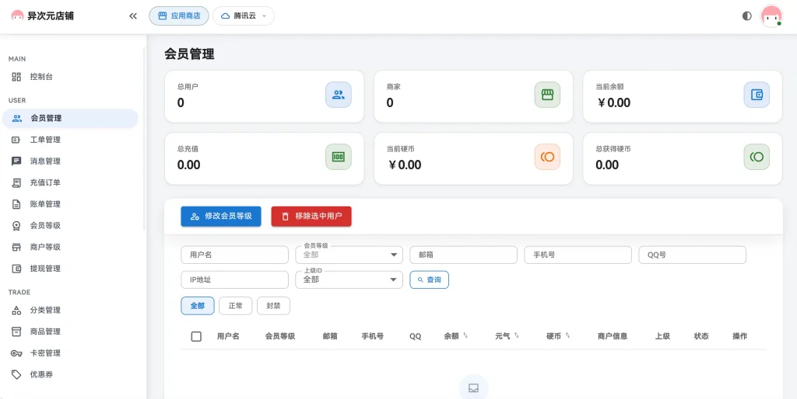

如果你想搭建一个属于自己的**在线发卡平台、数字商品商城、卡密销售网站**，但又不想花几百上千元购买商业源码，那么今天这个开源项目值得了解一下。

它就是 **ACG-Faka个人发卡源码，发卡系统，二次元发卡系统，二次元发卡源码，发卡程序，动漫发卡，PHP发卡源码，异次元发卡**，一款面向数字商品销售场景的开源发卡系统。配合 **宝塔面板**，普通用户也可以比较方便地完成网站环境搭建。🎉

## **🛒 ACG-Faka可以解决什么问题？**

传统的数字商品销售，需要人工确认订单、发送卡密，不仅效率低，还容易出现漏发、错发等问题。

通过发卡系统，可以将整个流程自动化：

**用户访问商城 → 选择商品 → 在线支付 → 系统自动发货 → 用户获取卡密**

整个过程无需人工干预，非常适合销售**游戏卡密、激活码、会员充值、数字账号以及其他虚拟商品**。

对于想做个人数字商品商城或者搭建自动化销售平台的用户来说，可以节省大量时间。💰

## **✨ 项目有哪些功能？**

### **🎫 自动发卡**

商品购买后自动完成发货，减少人工操作，提高订单处理效率。

### **🛍️ 在线商城**

可以创建自己的商品分类和商品页面，打造一个独立的数字商品销售平台。

### **👑 会员与等级体系**

支持不同等级用户，根据用户身份设置不同的商品价格和优惠策略。

### **🎁 优惠券与营销**

支持优惠券、批发优惠、限时秒杀等营销玩法，可以根据自己的业务需求进行推广。

### **🏪 分站系统**

支持分站模式，可以满足多商户、多店铺等场景需求，适合进一步扩展自己的发卡业务。

### **📢 推广返佣**

拥有推广和返佣相关功能，可以通过推广机制吸引更多用户参与平台推广。

### **🔌 插件扩展**

支持插件和应用扩展，可以根据自己的需求增加更多功能，让系统拥有更大的可扩展空间。

### **📱 移动端适配**

支持手机端访问，用户可以直接通过手机浏览商品和完成购买，使用更加方便。

## **🖥️ 宝塔面板如何搭建？**

如果你有一台云服务器，可以直接使用**宝塔面板搭建 ACG-Faka 发卡系统**。

大致流程：

1️⃣ 安装宝塔面板  
2️⃣ 创建网站并绑定域名  
3️⃣ 安装 Nginx、MySQL、PHP 等运行环境  
4️⃣ 上传 ACG-Faka 源码  
5️⃣ 创建并导入数据库  
6️⃣ 配置网站运行目录和伪静态  
7️⃣ 设置 PHP 运行环境  
8️⃣ 访问域名完成系统安装

整体部署流程对于有基础的站长来说并不复杂，搭建完成后就可以开始配置商品和商城。

⚠️ **建议部署前仔细阅读项目官方文档，根据项目要求配置 PHP 和数据库版本。**

## **💡 谁适合使用？**

如果你正在寻找：

✅ 开源发卡系统  
✅ 宝塔搭建发卡商城  
✅ 自动发卡源码  
✅ 卡密自动发货系统  
✅ 数字商品商城  
✅ 二次元商品销售平台  
✅ PHP 发卡系统  
✅ 支持分站的发卡平台

那么 ACG-Faka 可以作为一个不错的开源项目进行研究。

## **🌟 总结**

相比自己从零开发一个完整的数字商品商城，使用成熟的开源发卡系统可以大幅降低开发成本。

通过 **宝塔面板 + ACG-Faka**，可以快速搭建自己的在线发卡商城，实现**商品管理、订单管理、自动发货、会员体系、优惠营销、推广返佣以及分站运营**等功能。

如果你手里有一台云服务器，想尝试搭建自己的**数字商品自动发货平台**，这个项目还是值得体验一下的。🚀

### 前台截图：


### 后台截图：



## **安装教程**

在安装之前，请检查你的系统环境，php>=8.0，MySQL版本>=5.6[不推荐5.6后续升级可能会有问题，推荐5.7或者8.0]，因为使用了大量的PHP8注解以及PHP8的新特性，所以php版本不得不从8.0起，这里还需要注意。  
将源码下载至你的服务器、或者使用composer下载源码：composer create-project lizhipay/acg-faka  
以上步骤完成后，然后配置伪静态，Apache无需配置，根目录已经有.htaccess文件了，但如果你是Nginx，则需要配置伪静态。

- 下面是Nginx伪静态规则：

```
location ~* ^/(runtime|kernel|config|vendor)/                { return 404; }
location ~  /\.(?!well-known)                                { return 404; }
location ~* \.(log|sql|sqlite|db|db-wal|db-shm|bak|old|save|orig|swp|swo|tmp|ini|lock)$  { return 404; }
location ~* (~|composer\.(json|lock)|package(-lock)?\.json)$ { return 404; }
location / {
    try_files $uri $uri/ /index.php?s=$uri&$args;
}
```

- Windows IIS服务器环境，可以使用下面伪静态规则：

```
<rules>
	<rule name="acg_rewrite" stopProcessing="true">
		<match url="^(.*)$"/>
		<conditions logicalGrouping="MatchAll">
			<add input="{HTTP_HOST}" pattern="^(.*)$"/>
			<add input="{REQUEST_FILENAME}" matchType="IsFile" negate="true"/>
			<add input="{REQUEST_FILENAME}" matchType="IsDirectory" negate="true"/>
		</conditions>
		<action type="Rewrite" url="index.php?s={R:1}"/>
	</rule>
</rules>
```

- 配置完成后，访问你的首页，即可开始安装
- 安装完成后，后台地址是：**https://你的域名/admin**
- 前台信息**为你自定义的域名**

📌 **项目地址：**

**源码GitHub ：https://github.com/lizhipay/acg-faka**

**源码国内网盘下载：https://pan.quark.cn/s/bdc7d8e78d1a**
