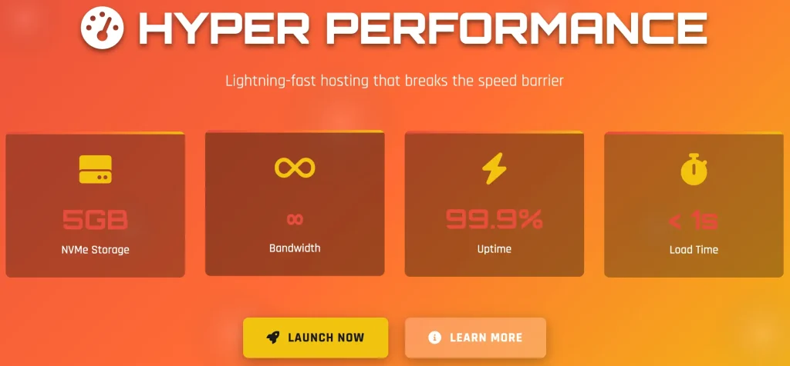
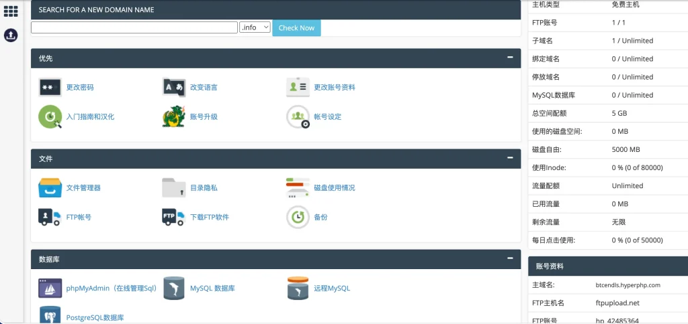

还在寻找稳定可用的海外免费虚拟主机？今天给大家分享 **HyperPHP**，一款主打高性能的永久免费 PHP 虚拟主机，适合搭建个人博客、导航站、小型演示站点。

## 📦 HyperPHP 免费主机核心配置

✅ **存储空间：5GB NVMe 高速固态硬盘**

区别于大量免费主机使用老旧机械硬盘，HyperPHP 采用 NVMe 存储，网站读写速度更佳，运行 WordPress、静态导航站点更流畅。

✅ **带宽流量：无限流量**

不限制月流量消耗，只要正常合规建站，不用担心流量超额关停站点。

✅ **运行环境：完整 PHP 虚拟主机**

支持自定义 PHP 版本，自带 Cron 定时任务、phpMyAdmin 数据库管理；免费额度提供不限数量 MySQL 数据库。

✅ **配套功能一览**

- 支持绑定自有域名、创建子域名
- 内置 FTP 管理、在线文件管理器
- 一键 SSL 证书部署，支持 HTTPS
- Softaculous 一键程序安装器（快速搭建 WP、Typecho 等程序）
- 提供访问日志、错误日志，方便排查网站故障

## 🌐 适合搭建哪些网站？

1. 个人技术博客、资源分享博客（WordPress / Typecho）
2. 开源导航站点、书签导航网页
3. 项目演示页面、静态展示官网
4. 学习测试用途的 PHP 程序环境

> ⚠️注意：海外免费虚拟主机普遍禁止违规内容、大文件下载站、采集站、高并发爬虫业务，遵守服务商规则才能长久使用。

## 💡 HyperPHP 使用优势

1. **控制面板汉化友好**

   面板自带中文语言切换，不用硬啃英文 cPanel，新手更容易上手操作。
2. **可搭配 Cloudflare CDN**

   域名接入 Cloudflare 后，既能隐藏主机原始地址、提升访问稳定性，同时加速国内访客打开速度。
3. **上线门槛低**

   注册即可开通，不需要信用卡验证，开通后立刻上传网站程序部署。
4. 承诺 **99.9% 在线率**，免费机里属于稳定性靠前的方案。

## ⚠️ 使用前必须了解的短板

1. 免费服务器位于海外，国内直连访问存在延迟，**强烈建议套 Cloudflare CDN 优化访问体验**
2. 免费机型存在资源限制，不适合流量巨大、高频数据库读写的网站
3. 免费主机无官方付费技术优先支持，遇到问题只能查阅文档或者论坛求助

## 📝 简单部署流程参考

1. 访问 hyperphp.com 注册账号开通免费主机
2. 在控制面板【绑定域名】添加你自己的域名
3. 域名 DNS 解析指向 HyperPHP 提供的服务器地址
4. 申请 SSL 证书，开启全站 HTTPS
5. 通过文件管理器 / FTP 上传网站源码，创建数据库完成安装

## 相关截图：

## ✍️ 总结

如果你需要一台零成本的海外 PHP 虚拟主机，用来搭建个人站点、项目演示，**HyperPHP** 是非常值得尝试的选择。5GB NVMe 空间 + 无限流量的配置，在同类永久免费主机中硬件规格很有竞争力。

建站完成后搭配 Cloudflare CDN，兼顾网站访问速度与安全防护，非常适合技术爱好者、博主日常使用。

**虚拟机申请地址：[https://hyperphp.com](https://hyperphp.com)**

**argon主题下载：[https://github.com/solstice23/argon-theme](https://github.com/solstice23/argon-theme)**

**国内网盘下载：[https://pan.quark.cn/s/267c50773092](https://pan.quark.cn/s/267c50773092)**

**puock主题下载：[https://github.com/Licoy/wordpress-theme-puock](https://github.com/Licoy/wordpress-theme-puock)**

**国内网盘下载：[https://pan.quark.cn/s/e001cf45331a](https://pan.quark.cn/s/e001cf45331a)**

---

> 本文转载整理自 [Ai星码博客](https://aixmb.com/661.html)，版权归原作者所有。

