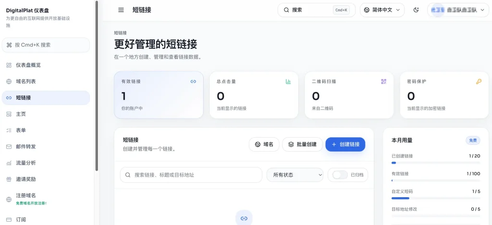
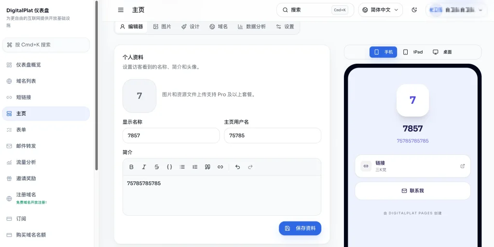
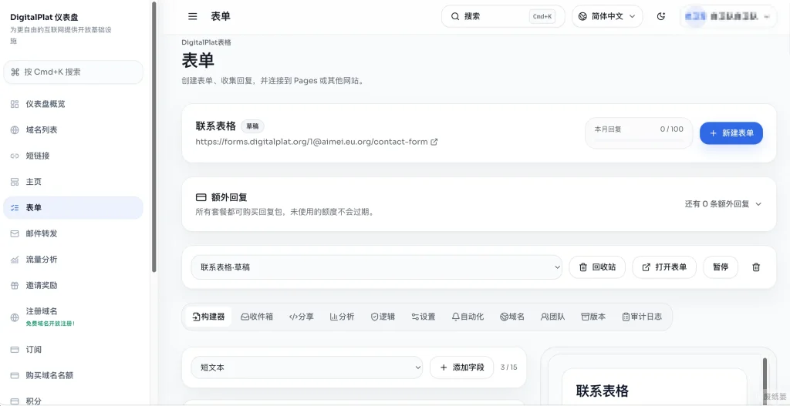
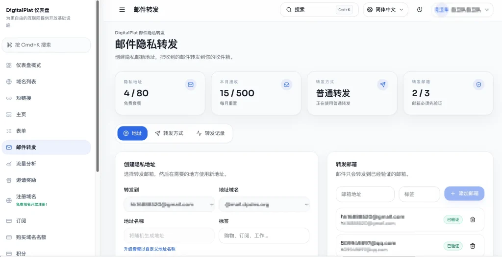
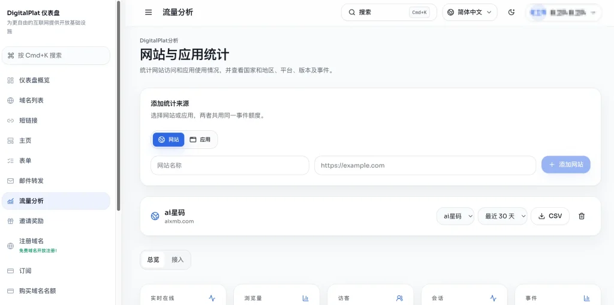

如果你正在寻找免费域名、短链接、个人主页、在线表单、邮件转发、网站流量分析等服务，那么可以了解一下 DigitalPlat FreeDomain。

这是一个开源项目，平台不仅提供域名注册，还整合了多种实用的网络服务。对于个人站长、开发者、学生以及喜欢折腾免费资源的朋友来说，还是非常值得收藏的。

👉 **项目已经在 GitHub 获得超过 18 万 Star，感兴趣的朋友可以去看看。**

⸻

**🌐 免费域名注册**

目前平台注册页面提供以下域名后缀：

- ✅ **.qd.je**

- ✅ **.dpdns.org**
- 💰 **.xx.kg**
- 💰 **.qzz.io**
- 💰 **.qd.je**
- 💰 **.us.kg**

需要注意的是，目前真正可以使用免费名额注册的域名后缀，主要是截图箭头标注的两个：**.qd.je 和 .dpdns.org**。

而 .xx.kg、.qzz.io、.us.kg 等后缀目前需要使用付费名额或按量付费才能注册，并不是无法注册。

⚠️ 另外，如果你以前已经免费注册过这些域名后缀，即使现在新注册需要付费，之前已经注册成功的域名依然可以继续使用。

所以，如果你想零成本注册新域名，可以优先选择目前支持免费名额的后缀。

### **⏰ 免费域名有效期**

免费注册的域名**有效期为 1 年**。

在域名到期前 **120 天**，可以提前进行续费操作，按照平台规则完成续费后即可继续使用。

⚠️ 如果你之前已经成功注册了 **.xx.kg、.qzz.io、.us.kg** 等后缀，即使现在新注册需要付费，**之前已经注册的域名依旧可以继续使用**，按照平台的续费规则正常管理即可。

⸻

**🔗 免费短链接**

Free 免费套餐每月可以创建 20 个短链接，并支持多种实用功能：

🔐 密码保护  
⏰ 定时访问  
📱 二维码生成  
🔌 API 接口

对于个人博客、项目分享、社交媒体链接等场景都比较实用。

⸻

**🏠 免费个人主页**

免费套餐支持创建 2 个主页，每个主页最多放置 15 个内容模块。

目前免费套餐包含：

* DigitalPlat 域名：1 个  
* 其他服务商域名：0 个

可以用来制作个人介绍页、个人导航页、项目展示页等。

⸻

**📝 在线表单**

Free 套餐还提供在线表单功能：

* 📋 3 个表单  
* 📩 每月 100 条回复  
* 📝 每个表单最多 15 个字段  
* 📅 回复保存 30 天  
* 💰 支持按量付费增加回复额度

对于收集用户反馈、报名信息、问卷调查等需求，基本够个人用户使用。

⸻

**📧 免费邮件转发**

免费套餐提供：

* 📮 80 个隐私地址  
* ✉️ 每月 500 封邮件  
* 📬 3 个已验证转发邮箱

如果你想使用域名邮箱，又不想自己搭建复杂的邮件服务器，邮件转发功能还是非常方便的。

⸻

**📊 免费网站流量分析**

Free 套餐还支持网站和应用数据分析：

* 🌐 统计网站或应用：1 个  
* 📈 每月用户行为：10,000 次  
* 📅 查看最近 30 天报表

可以帮助个人站长了解网站访问数据和用户行为。

⸻

💰 Free 免费套餐值不值得？

DigitalPlat 的 Free 套餐价格为：$0/月 🎉

每个账户均可免费使用。

免费套餐包括：

**🌐 免费域名注册**  
**🔗 每月 20 个短链接**  
**🏠 2 个个人主页**  
**📝 3 个在线表单**  
**📧 80 个隐私邮件地址**  
**✉️ 每月 500 封邮件**  
**📊 1 个网站流量分析**

如果免费额度不够，还可以通过按量付费的方式增加相关资源。

⸻

**🚀 付费功能？我们教你零成本搭建！（请看我往期教程）**

如果你发现平台部分功能需要付费，或者免费额度不够，其实也不用急着充值。

我们之前已经发布过不少零成本搭建教程，利用 Cloudflare、GitHub 以及各种开源项目，可以自己搭建类似的：

🔗 短链接系统  
🏠 个人主页  
📝 在线表单  
📧 邮件转发  
📊 网站统计  
🛠️ 在线工具

很多功能都可以通过免费平台 + 开源项目实现，省下服务器和软件成本。

如果你喜欢折腾，完全可以跟着教程自己部署，拥有更高的自由度，也不用担心平台免费额度不够的问题。

⸻

⭐ 总结

DigitalPlat FreeDomain 不仅仅是一个免费域名项目，还提供了短链接、个人主页、在线表单、邮件转发和流量分析等一系列服务。

目前想要免费注册新域名，可以重点关注：

👉 .qd.je  
👉 .dpdns.org

而 .xx.kg、.qzz.io、.us.kg 等后缀目前可以注册，但需要使用付费名额或按量付费。

如果你之前已经注册过这些后缀，那么已经注册的域名依然可以继续使用。

对于个人站长来说，如果你喜欢免费域名、免费建站、Cloudflare、GitHub 和开源项目，这个项目值得收藏。🚀

### 相关截图：

👉 **项目开源地址： [https://github.com/DigitalPlatDev/FreeDomain](https://github.com/DigitalPlatDev/FreeDomain)**

👉**美国地址生成器：**[**https://address.aixmb.cn**](https://address.aixmb.cn)

---

> 本文转载整理自 [Ai星码博客](https://aixmb.com/680.html)，版权归原作者所有。

