如果你做过网站、写过代码、甚至只是偶尔搞点数据处理，你一定遇到过这种情况：

“我就想转换个 JSON，结果打开了 5 个网站……”  
“UUID 生成一下，还要注册？”  
“Base64 解码？广告比结果还多……”

说白了就是一句话：

👉 工具太碎，太乱，太烦。

直到我发现这个项目：  
👉 **IT-Tools（GitHub 3万+ Star）**

它直接把一堆开发工具做成了一个“工具超市”，而且——

❗完全免费 + 无广告 + 打开就能用 + 还支持自部署

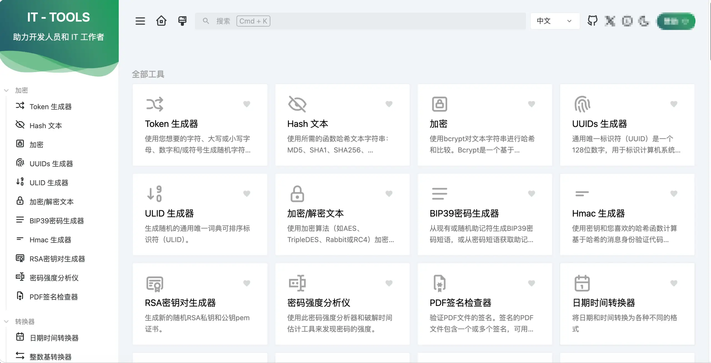

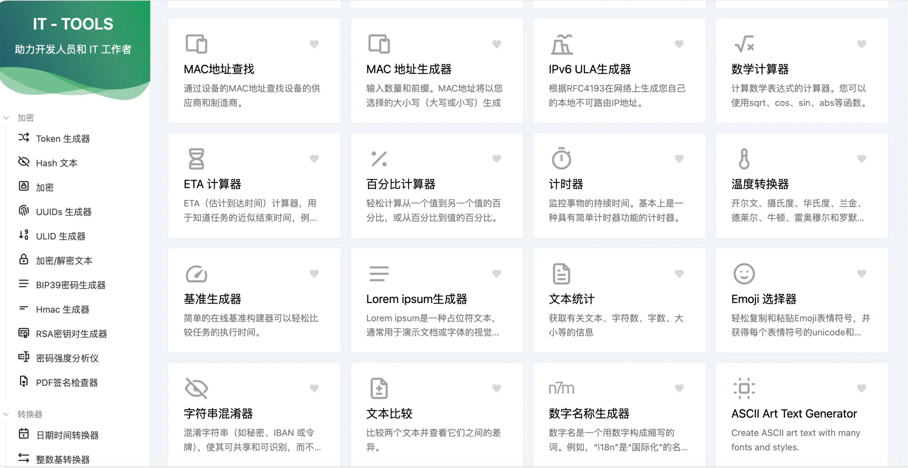

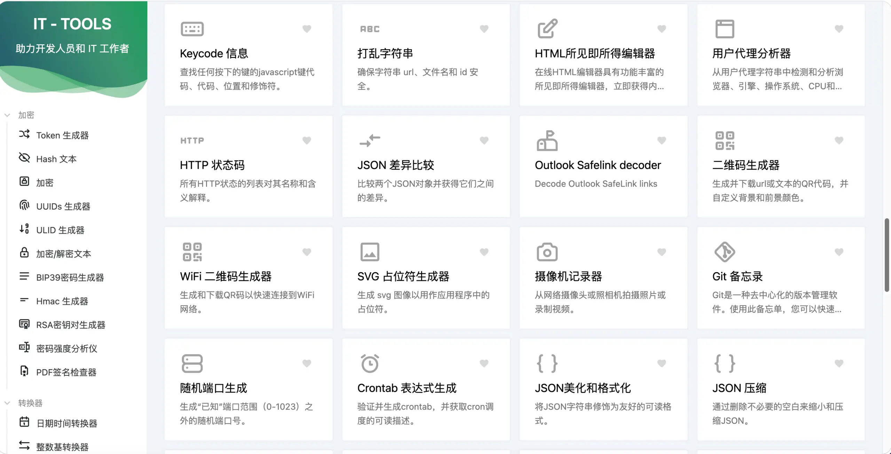

**演示站：[https://tools.kixtools.com](https://tools.kixtools.com)**

---

# **🧰 一、IT-Tools 到底是干嘛的？**

一句话解释：

👉 它就是一个“开发者万能工具箱网站”

你可以把它理解成：

- 浏览器里的“瑞士军刀”
- 程序员的“计算器合集升级版”
- 或者说：一站式工具平台

打开之后不是一个功能，而是几十个分类👇

---

# **⚡ 二、它到底有哪些功能？（重点来了）**

我帮你按“真实使用场景”整理了一下👇

---

## **🧾 1. 数据格式转换（最常用）**

这个模块基本是刚需：

- JSON 格式化 / 压缩
- JSON ⇄ CSV
- YAML ⇄ JSON
- XML 格式化
- SQL 美化
- Markdown ⇄ HTML

👉 以前你要打开各种网站  
👉 现在一个页面全搞定

---

## **🔐 2. 加密 & 安全工具**

如果你做接口开发，这块非常香：

- MD5 / SHA 加密
- HMAC 计算
- JWT 解码
- bcrypt 密码生成
- 密码强度生成器
- Token 生成

👉 特别适合后端 / API 调试

---

## **🌐 3. 网络工具（运维最爱）**

这一块基本就是“运维工具箱”：

- IP 地址解析
- MAC 地址生成
- DNS 查询工具
- URL 解析
- Ping / Telnet / Curl 工具辅助
- HTTP 状态码查询

👉 很多小工具你平时都要去网站搜，现在直接内置

---

## **🧮 4. 编码 / 解码工具**

这个真的高频：

- Base64 编码 / 解码
- URL 编码
- HTML Entities 转换
- 二进制转换

👉 写接口、调 API 的人天天用

---

## **🧑‍💻 5. 开发辅助工具（很实用）**

这一类是“细但很重要”：

- 正则表达式测试
- Cron 表达式生成器
- Markdown TOC 自动生成
- 代码格式化
- 代码 diff 对比

👉 属于“用一次就离不开”

---

## **🎨 6. UI & 前端工具**

前端开发会很喜欢：

- HEX ⇄ RGB 颜色转换
- SVG 占位图生成
- QR Code 生成器
- CSS 格式化

---

## **🆔 7. 各种“生成器”**

这一类最爽：

- UUID / ULID 生成
- 随机密码生成
- 随机字符串
- 时间戳转换
- Base 时间计算

👉 很多项目初始化直接用

---

## **📝 8. 文本处理工具**

- 字符统计
- 大小写转换
- 去空格 / 清洗文本
- ASCII 转换
- 文本 diff

---

# **💡 三、这个项目真正厉害的地方**

说实话，这种工具站很多，但 IT-Tools 特别强在这几点：

---

## **✅ 1. 全部在浏览器运行（隐私安全）**

👉 不上传服务器  
👉 不存数据  
👉 你输入什么，都是本地处理

---

## **✅ 2. 没广告（体验极好）**

你用过一些在线工具站就知道：

- 弹窗广告
- 下载按钮陷阱
- 一堆 SEO 垃圾内容

IT-Tools：干净得像“系统工具”

---

## **✅ 3. 超级快（Vite + Vue）**

打开几乎秒加载  
工具切换几乎无延迟

---

## **✅ 4. 可以自己部署**

这个项目还能：

👉 一键部署到 Cloudflare / Vercel / Docker

也就是说：

你可以做一个“属于自己的工具站”

---

# **🚀 四、它适合谁用？**

如果你是这些人👇

- 👨‍💻 程序员 / 前端 / 后端
- 🧑‍🔧 运维 / DevOps
- 🧠 做 API 调试的人
- 🧰 做网站工具站的人
- 📊 偶尔处理数据的人

👉 基本都会用到

---

# **🔥 五、我为什么推荐它？**

因为它解决了一个很现实的问题：

“我们不是缺工具，而是工具太分散。”

IT-Tools 做的事情很简单：

👉 把 100+ 小工具，全部塞进一个网站

而且做得非常干净、非常快、非常顺手。

---

# **🧠 六、如果你想玩点更进阶的（重点）**

这个项目其实还能延伸出很多玩法：

### **💰 1. 做工具站赚钱**

- 加 AdSense
- 做 SEO 流量
- 做“开发者工具导航站”

### **🌍 2. 多语言版本**

- 中文版 IT-Tools
- 面向国内流量

### **⚙️ 3. Cloudflare 免费部署**

- 零服务器成本
- 全球访问加速

---

# **🧾 最后一句话总结**

👉 IT-Tools 不只是一个工具网站  
👉 它更像是“开发者的系统工具合集”

如果你做开发、做网站、甚至只是想提高效率—这个项目真的可以收藏。

# **七、****搭建教程：**

1.Fork / 克隆源码到自己 GitHub 仓库

```
https://github.com/CorentinTh/it-tools
```

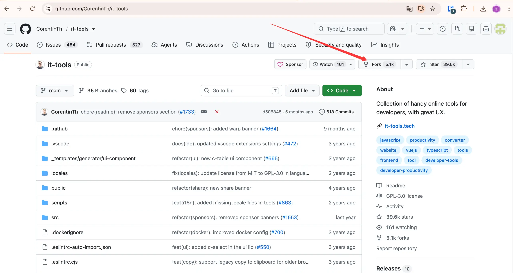

2.自定义项目名称或保持默认，点击create fork

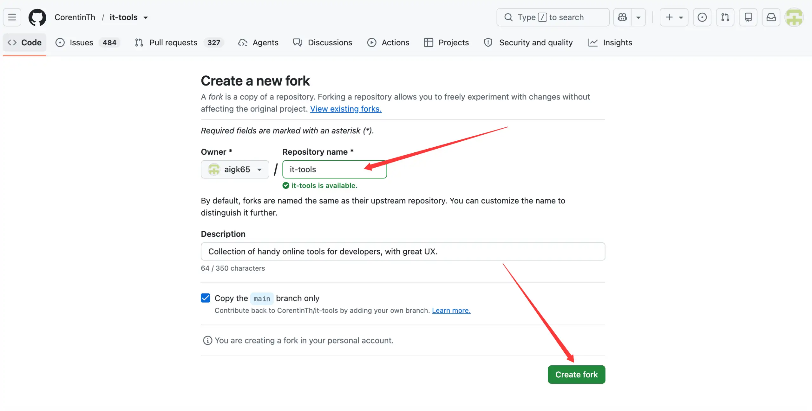

3.登录 Cloudflare 后台 → 左侧菜单 **Workers & Pages**点击→**创建应用程序

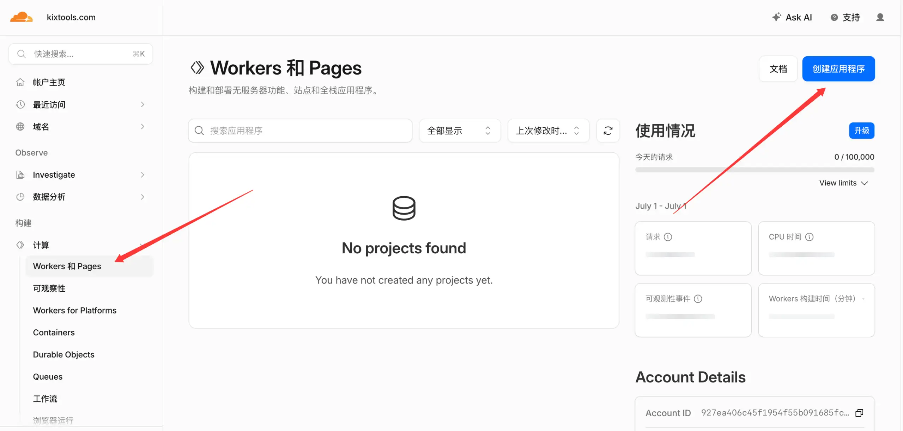**

4.选择 **Pages** → **连接到 Git**

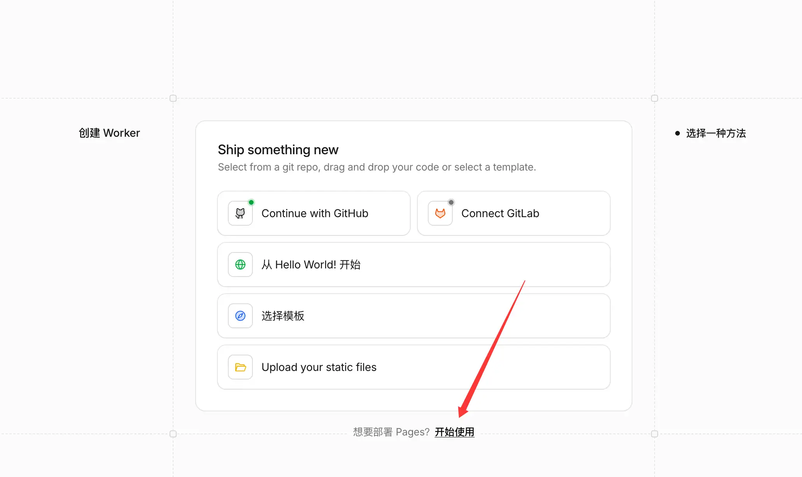

5.授权自己的**Git账号**

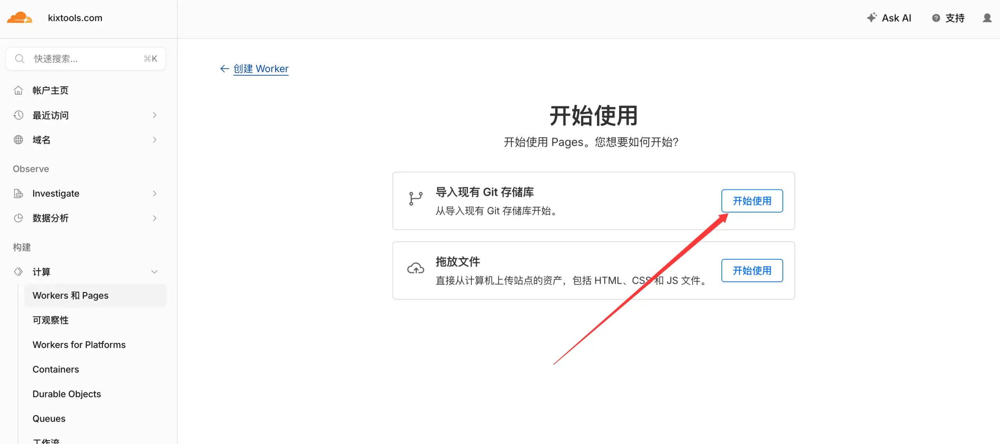

6.授权 Cloudflare 访问你的 GitHub，找到你 fork 后的 it-tools 仓库，点开始设置

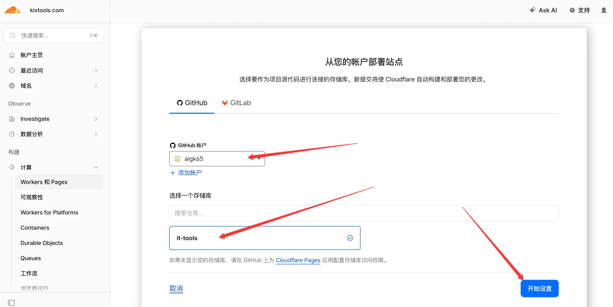

7.项目名称自定义，生产分支mian，框架预设vue，构建命令 npm run build，构建输出目录 dist，点击保存并部署

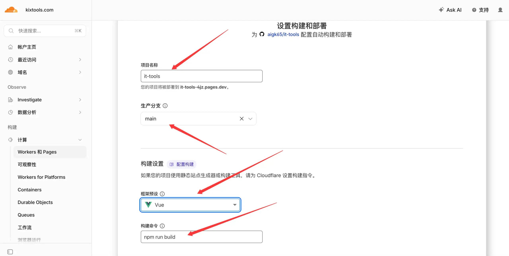

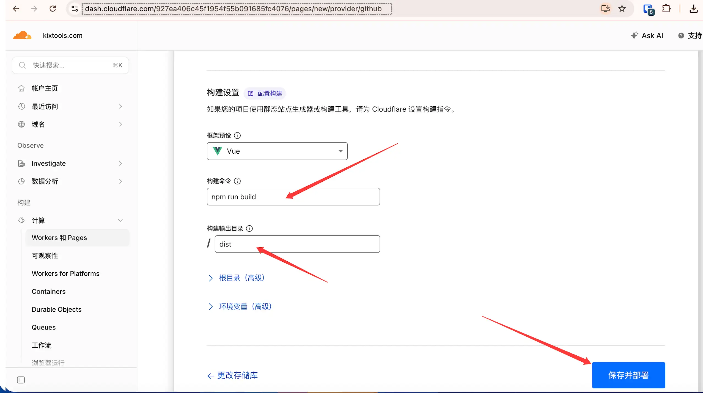

8.部署完成后cloudflare进入默认域名即可访问。国内访问需要自定义域名。

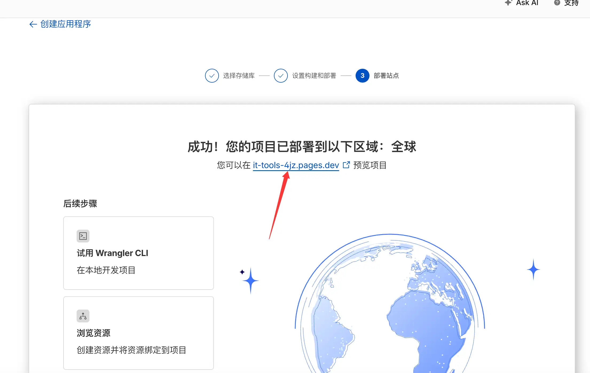

9.左侧菜单**Workers & Pages，点击刚刚部署完成的项目。**

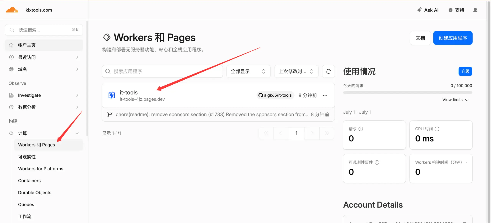

10.自定义已经托管在Cloudflare的域名即可。

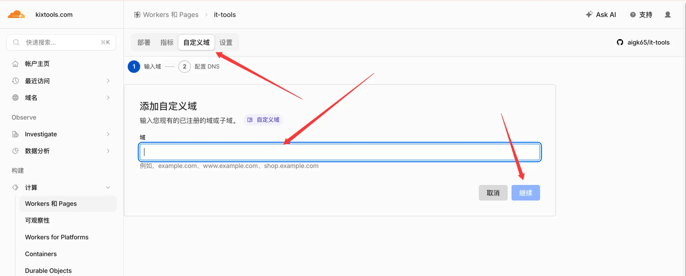

---

> 本文转载整理自 [Ai星码博客](https://aixmb.com/69.html)，版权归原作者所有。

