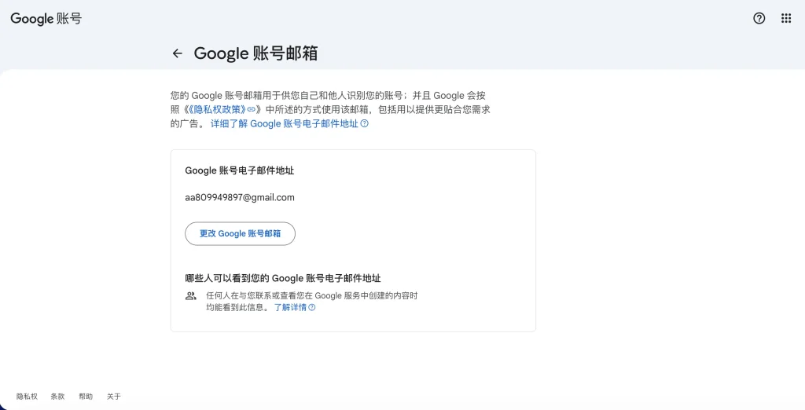
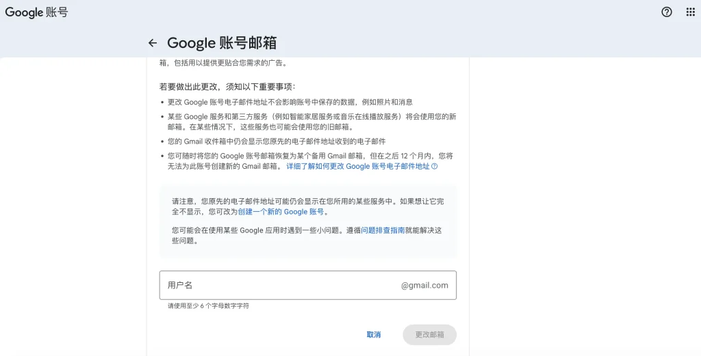
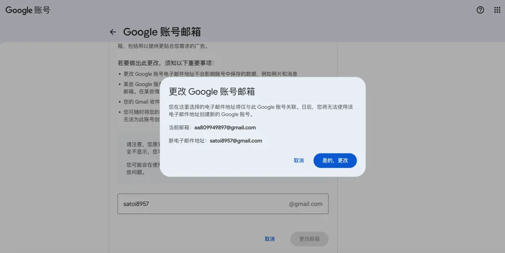
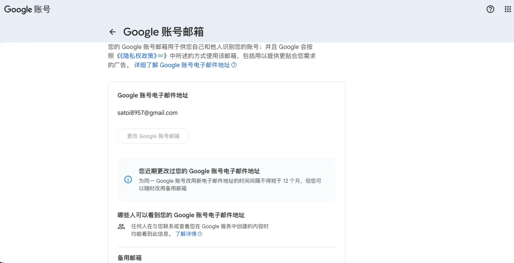

你有没有一个 Gmail 邮箱，用了很多年却一直不满意？

比如：

📧 coolboy1998@gmail.com

📧 love520xxx@gmail.com

📧 一串当年随手注册的数字账号……

年轻的时候觉得无所谓。

但随着年龄增长：

💼 工作联系  
🌍 海外注册  
📂 商务合作  
🔐 网站账号绑定

才发现：

邮箱名字，真的很影响专业度。

过去 Gmail 最大的问题就是：

注册后无法修改前缀。

想换？

只能重新注册一个新的 Google 账号。

但是现在，这个限制终于出现变化！

⸻

🎉 Gmail 支持修改邮箱前缀！

最近，不少用户发现：

Google 账号设置里面出现了新的功能：

「更改 Google 账号邮箱」

这意味着：

以前：

📧 oldname@gmail.com

只能一直使用。

现在：

📧 oldname@gmail.com

可以修改为：

📧 newname@gmail.com

并且：

✅ 不需要重新注册 Google 账号  
✅ 原来的邮件数据保留  
✅ Google Drive 文件不会丢失  
✅ YouTube、Google Photos继续使用

你的 Google 账号还是原来的账号，只是邮箱名字发生变化。

⸻

📸 Google账号设置页面

进入修改地址：[**http://myaccount.google.com/google-account-email**](http://myaccount.google.com/google-account-email)

登陆自己的谷歌账号，选择：更改 Google 账号邮箱

输入新的 Gmail 前缀即可。

⸻

📸 修改邮箱页面

输入新的用户名后：

Google 会检测是否可以使用。

如果没有被占用，就可以完成修改。

⸻

⚠️ 修改 Gmail 前，一定要注意这个变化

很多用户最关心的问题：

“修改之后，原来的 Gmail 地址还能不能正常使用？”

答案：

需要谨慎看待。

根据 Google 页面提示：

修改后：

新的 Gmail 地址会成为你的主要邮箱。

而旧 Gmail 地址会被保留为：

备用 Gmail 地址。

⸻

📸 Google官方提示

页面显示：

旧 Gmail 地址会作为备用邮箱存在。

⸻

那备用 Gmail 地址是什么意思？

很多人容易误解：

备用邮箱 ≠ 新 Gmail 别名。

它主要用于：

✅ 账号恢复  
✅ 身份验证  
✅ 安全提醒  
✅ 找回 Google 账号

但 Google 并没有明确保证：

旧 Gmail 地址一定长期保持和以前一样的收件功能。

所以：

如果你的旧邮箱绑定了重要业务：

⚠️ 建议提前做好迁移。

例如：

* 工作邮箱  
* 客户联系方式  
* 网站注册账号  
* 海外平台账号

⸻

修改后数据会不会消失？

这个大家不用担心。

修改 Gmail 地址后：

✅ Gmail 历史邮件保留

✅ Google Drive 文件保留

✅ Google Photos照片保留

✅ YouTube账号保留

✅ Google账号数据不会丢失

最大的变化：

只是你的 Gmail 地址更新了。

⸻

Google为什么现在开放这个功能？

其实很多用户已经期待多年。

因为互联网时代变化太快。

很多人的 Gmail：

注册时只是为了：

🎮 游戏账号

📱 社交平台注册

后来却变成：

💼 工作身份

🌍 海外数字身份

📂 云端资料中心

一个邮箱，可能陪伴用户十几年。

Google 这次更新，本质上是在解决：

数字身份无法跟随用户成长的问题。

⸻

哪些人最适合修改？

✅ 年轻时随便注册邮箱的人

例如：

以前：

xiaoming520@gmail.com

现在：

xiaoming@gmail.com

更加正式。

⸻

✅ 做海外业务的人

一个简单专业的邮箱，会提升信任感。

⸻

✅ 长期使用 Google 服务的人

不用重新建立新的账号体系。

⸻

📸 修改成功后的效果

修改完成后：**(经过博主测试刚修改完后新前缀和原前缀均能收到邮件，后期未知)**

新的 Gmail 地址成为主要邮箱。

旧地址显示为备用 Gmail。

⸻

总结

Gmail 这次更新，可以说是 Google 用户期待多年的变化。

以前：

换邮箱 = 换账号

现在：

换邮箱 = 保留账号和数据

不过提醒大家：

如果你的旧邮箱已经使用多年，修改之前一定检查：

✅ 重要联系人  
✅ 网站绑定邮箱  
✅ 工作账号  
✅ 海外平台登录信息

确认无误后再修改。

你的 Gmail 邮箱名字后悔过吗？

评论区聊聊👇
