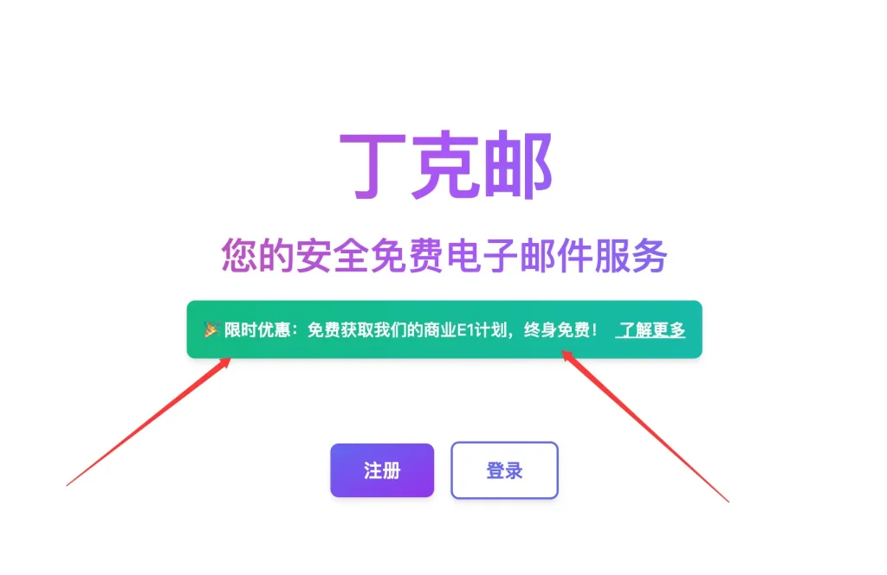
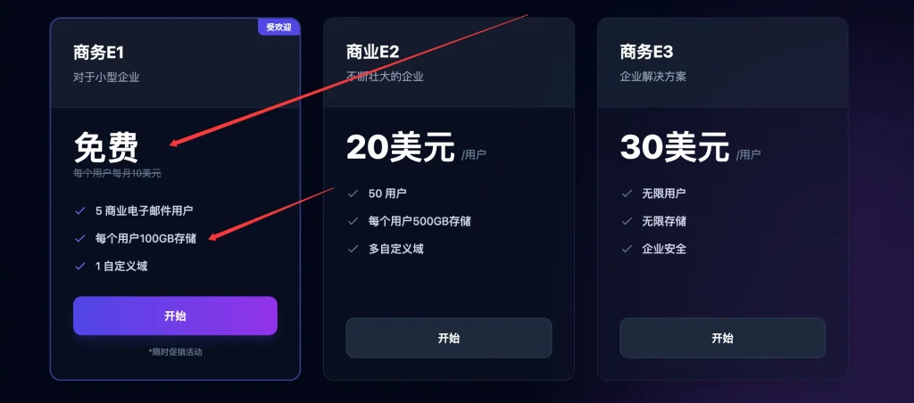
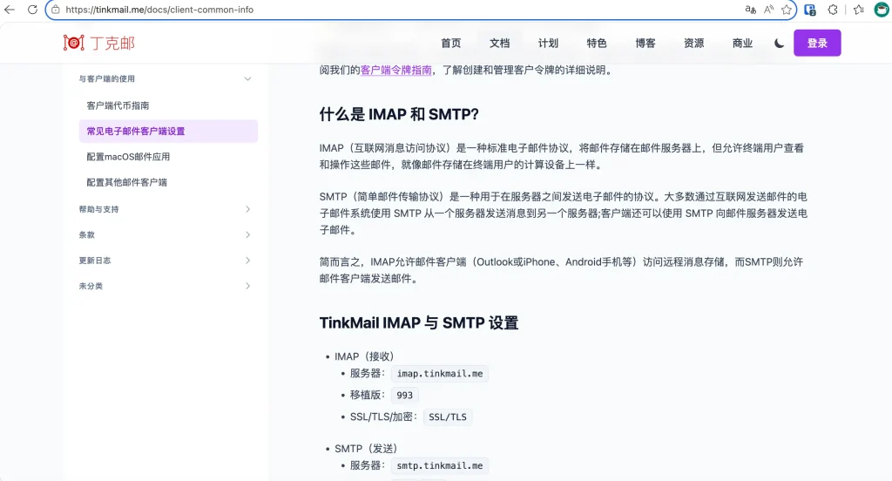
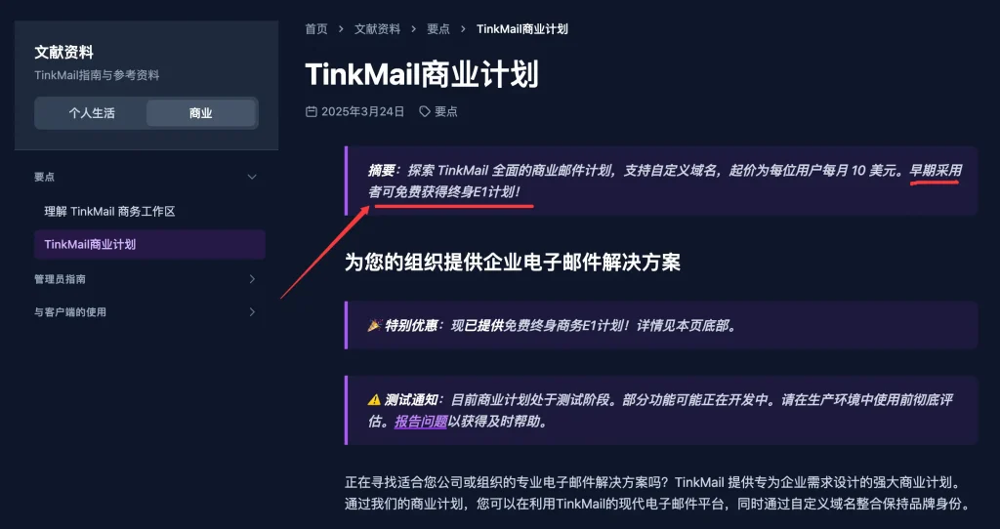
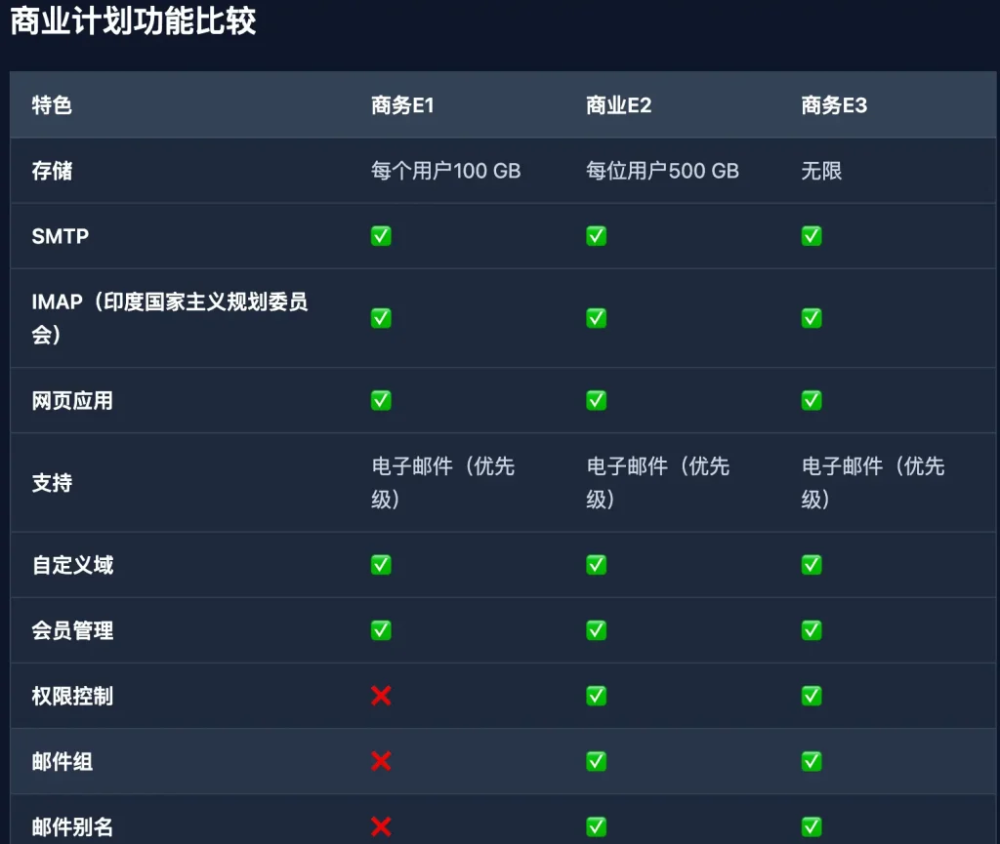

很多人在注册网站、运营博客、做外贸、搭建个人品牌的时候，都会遇到一个问题：

**普通 Gmail、QQ 邮箱、163 邮箱看起来太个人化，不够专业。**

比如：

❌ contact123@gmail.com  
❌ 123456@qq.com

发给客户、合作伙伴的时候，总感觉少了一点可信度。

而真正专业的网站和企业，通常都会使用自己的域名邮箱：

✅ admin@你的域名.com  
✅ support@你的域名.com  
✅ hello@你的域名.com

不仅提升品牌形象，也方便长期运营。

但是问题来了：

很多企业邮箱价格并不便宜。

Google Workspace、Microsoft 365 等服务，每个月都需要付费。

有没有一个：

✅ 支持自定义域名  
✅ 免费使用  
✅ 支持 SMTP/IMAP  
✅ 可以绑定自己的域名  
✅ 适合个人站长、小团队使用

的邮箱服务？

今天发现一个比较特别的平台：

# **TinkMail —— 免费安全的域名邮箱服务**

---

## **🎉限时活动：免费领取商务 E1 企业邮箱计划**

目前 TinkMail 推出了限时优惠活动：

**早期用户可以免费获得 Business E1 商业邮箱计划。**

官方介绍显示，Business E1 原本价格为：

💰10 美元 / 用户 / 月

但目前符合条件的用户可以免费使用。

注意：平台目前部分商业功能仍处于发展阶段，建议重要企业生产环境使用前做好测试。

---

# **📌TinkMail 可以做什么？**

简单来说：

它就是帮你创建一个属于自己的专业邮箱系统。

例如你拥有：example.com

绑定以后，可以创建：admin@example.com  support@example.com  hello@example.com

以后网站联系、客户沟通，都可以使用自己的品牌邮箱。

TinkMail 首页展示“安全免费电子邮件服务”，支持个人和商业邮箱使用。

---

# **🆓 Business E1 免费计划有什么？**

根据官方商业计划介绍，目前 Business E1 包含：

## **✅ 5个商业邮箱用户**

例如：

admin@你的域名.com

sales@你的域名.com

support@你的域名.com

最多可以创建多个团队邮箱账号。

## **✅ 每个用户 100GB 邮箱空间**

相比很多免费邮箱几 GB 的空间：

100GB 对于普通网站运营已经非常充足。

可以存储：

- 网站通知邮件
- 客户沟通记录
- 文件附件
- 商务资料

---

## **✅ 支持自定义域名**

这是很多免费邮箱没有的功能。

你可以绑定：自己的域名：yourdomain.com

然后创建：name@yourdomain.com

真正拥有企业级邮箱体验。

---

Business E1 当前限时免费，支持5个商业邮箱用户，每个用户100GB存储空间，一个自定义域名。

---

# **📮支持 IMAP 和 SMTP，可连接各种邮箱客户端**

很多人担心：

“是不是只能网页登录？”

答案：

不是。

TinkMail 支持：

✅ Outlook

✅ Apple Mail

✅ Thunderbird

✅ 手机邮箱客户端

通过 IMAP 收邮件：imap.tinkmail.me  
端口：993  
SSL/TLS

发送邮件：smtp.tinkmail.me  
端口：465 / 587  
SSL/TLS

# 

TinkMail支持标准IMAP和SMTP协议，可以连接第三方邮箱客户端。

---

# **为什么推荐站长和个人开发者关注？**

如果你是：

## **🌐 网站站长**

可以创建：admin@网站.com

用于：

- 网站联系
- 用户反馈
- 合作咨询

---

## **🛒 电商卖家**

可以创建：service@商城.com

升客户信任感。

---

## **👨‍💻 开发者**

可以用于：

- GitHub项目邮箱
- API服务通知
- 域名注册邮箱
- SaaS产品邮箱

---

## **✍️ 博客作者**

例如：hello@你的博客.com

比普通邮箱更加专业。

---

# 

TinkMail商业计划支持自定义域名、团队管理和企业邮箱功能。

---

# **TinkMail有哪些功能？**

整理一下：

## **🔥核心功能**

✅ 自定义域名邮箱

✅ Web邮箱管理

✅ SMTP发送邮件

✅ IMAP同步邮件

✅ 多设备访问

✅ 垃圾邮件防护

✅ 域名安全保护

✅ 团队成员管理

---

# **注册流程简单吗？**

基本流程：

## **第一步**

注册 TinkMail 账号

## **第二步**

进入 Business Workspace

## **第三步**

添加自己的域名

## **第四步**

按照提示添加 DNS 记录

## **第五步**

创建邮箱账号

完成后即可使用：xxx@你的域名.com

# 

官网提示限时优惠，用户可以免费获取 Business E1 计划。

---

# **和普通邮箱相比有什么区别？**

| **类型** | **普通邮箱** | **域名邮箱** |
| --- | --- | --- |
| 地址 | xxx@gmail.com | ✅ admin@xxx.com |
| 品牌感 | 一般 | ✅ 专业 |
| 企业形象 | 较弱 | ✅ 更强 |
| 可控性 | 低 | ✅ 高 |
| 长期运营 | 一般 | ✅ 推荐 |

# **写在最后**

对于个人站长、小团队、独立开发者来说，一个专业邮箱其实非常重要。

以前创建域名邮箱：

需要购买企业邮箱套餐。

现在 TinkMail 提供了一个低成本甚至免费的选择。

如果你刚好：

✅ 有自己的域名  
✅ 正在做网站  
✅ 运营博客  
✅ 做海外项目  
✅ 需要专业联系方式

可以趁活动期间体验一下。

不过也提醒大家：

免费服务都有一定风险，重要业务邮箱建议做好备份，不要把所有核心账号只绑定一个邮箱。

---

### **🔗项目地址：[https://tinkmail.me](https://tinkmail.me/)**

---

> 本文转载整理自 [Ai星码博客](https://aixmb.com/708.html)，版权归原作者所有。

