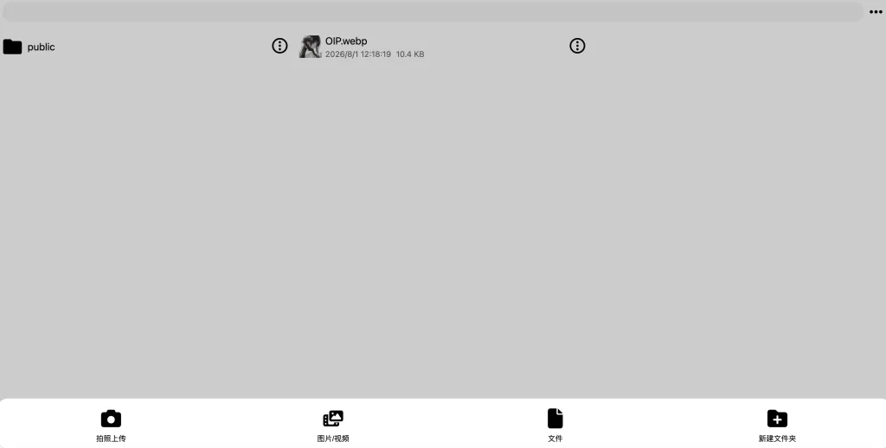

很多人都有这样的烦恼：

📂 文件越来越多  
📸 图片素材没地方放  
🎬 视频资源占空间  
🤖 AI 模型文件越来越大

用网盘：

❌ 下载限速  
❌ 广告多  
❌ 数据不完全属于自己

买服务器：

❌ 成本高  
❌ 需要维护  
❌ 配置麻烦

有没有一种方式：

既能拥有自己的存储空间，又不用天天维护服务器？

答案就是：

**Cloudflare R2 + Cloudflare-R2-oss**

---

## ☁️ 使用前需要先开通 Cloudflare R2

想要搭建自己的云存储，第一步需要开启 Cloudflare 的 **R2 对象存储服务**。

进入 Cloudflare 控制台：

**R2 → 开始使用（Get Started）**

按照提示开通即可。

开通后创建一个 **Bucket（存储桶）**，这个 Bucket 就相当于你的云端硬盘。

之后项目会连接这个 R2 存储空间，实现文件上传、管理和访问。

Cloudflare R2 提供免费额度：

✅ 每月 10GB 存储空间  
✅ 免费请求额度  
✅ 无需购买服务器

## ☁️ Cloudflare R2 是什么？

简单来说：

它就是一个云端硬盘。

可以存储：

✅ 图片  
✅ 视频  
✅ 文档  
✅ 压缩包  
✅ 网站资源  
✅ AI 数据文件

而且依托 Cloudflare 全球网络，访问速度和稳定性都不错。

---

## 🚀 这个项目能干什么？

Cloudflare-R2-oss 主要解决一个问题：

**让普通用户更方便地使用 R2。**

它可以帮助你：

### 📤 文件管理

方便上传、管理自己的文件。

不用一直操作复杂命令。

---

### 🖼 搭建私人图床

以后：

博客图片

网站素材

Markdown 图片

都可以放自己的存储里。

---

### 🌐 网站资源托管

网站里的：

- 图片
- JS
- CSS
- 静态文件

都可以交给 R2 存储。

降低服务器压力。

---

### 📦 打造个人资源库

例如：

AI 工具合集

学习资料

软件资源

设计素材

全部可以整理保存。

---

## 🤖 为什么值得关注？

现在 AI、网站、自媒体发展越来越快。

我们的数字文件越来越多。

把数据完全交给第三方平台：

并不是最好的选择。

拥有一个自己的云存储空间，

正在成为越来越多人的选择。

---

## 👨‍💻 适合哪些人？

✅ 程序员  
✅ 网站站长  
✅ 自媒体作者  
✅ AI 玩家  
✅ 想搭建私人云盘的人

---

## ❤️ 写在最后

Cloudflare R2 本身很强大，

但很多人卡在：

“不知道怎么用。”

而 Cloudflare-R2-oss 这类开源项目，

就是降低使用门槛，让更多人可以轻松拥有自己的云存储。

如果你正在寻找：

☁️ 私人云盘方案  
🖼 图片托管方案  
📂 文件存储方案  
🌐 网站资源加速方案

这个项目值得收藏。

## ❤️ 搭建教程

1. 叉子该仓库
2. 前往Cloudflare R2新建一个R2存储桶，并前往存储桶设置，允许公开访问，复制**公共存储桶URL**
3. 前往Cloudflare Pages新建一个节点，选择连接到Git

4.选择刚刚fork的仓库，点击开始设置5.项目名称可以修改，其他项目保持默认不动

6.展开环境变量，添加

| 变量名称 | 值 |
| --- | --- |
| PUBURL | 复制的**公共存储桶URL** |
| GUEST | public/ |
| admin:123456 | * |
| user1:123456 | user1/,userPublic/ |

以此类推允许，GUEST代表游客的写入目录

管理员则以账号:密码的形式设置，值代表其允许写入的目录，用,隔开，请勿在前后加逗号，否则会授予所有目录的写入权限

设置好后点击开始配置

7.前往Pages->cloudflare-r2-oss->设置->函数->R2存储桶绑定,绑定R2存储桶,变量名称BUCKET

8.在配置页面重新配置即可

### **🔗****项目地址：**[https://github.com/ljxi/Cloudflare-R2-oss](https://github.com/ljxi/Cloudflare-R2-oss)
