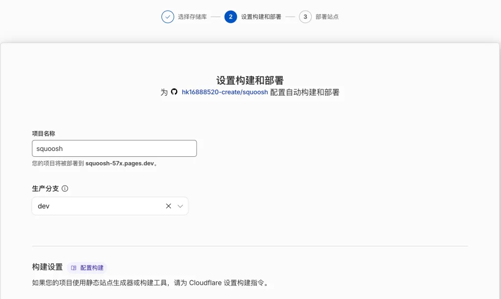
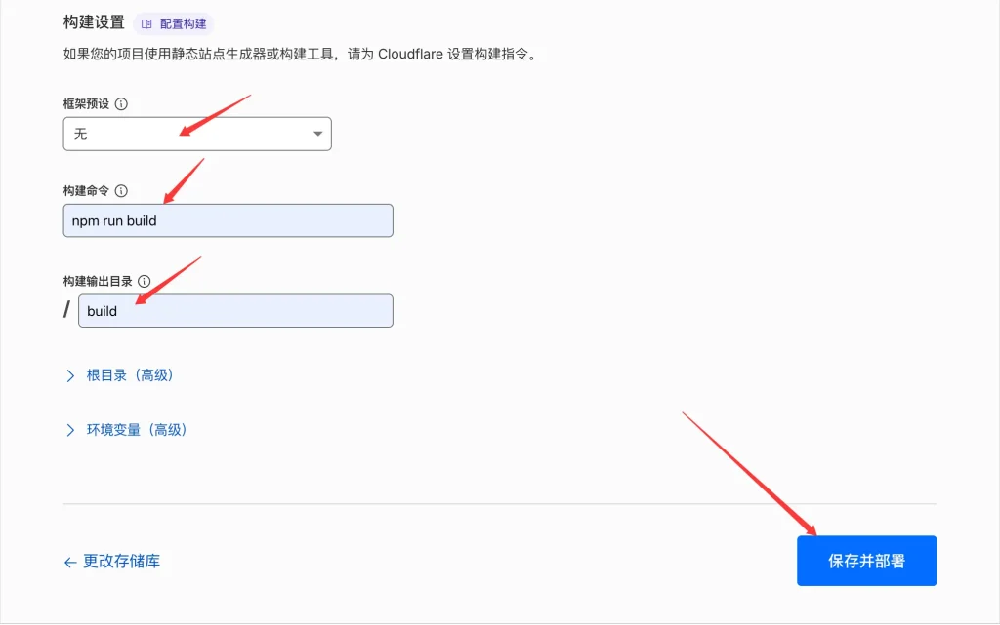

你有没有遇到过这样的烦恼？

手机拍了一张照片。

准备上传的时候，却突然提示：

❌ 图片太大，无法上传  
❌ 文件超过限制  
❌ 图片格式不支持

明明只是上传一张照片，为什么总是这么麻烦？

---

## 手机照片越来越清晰，但也越来越“大”📱

现在手机摄像头越来越强。

随手拍一张照片：

几MB很正常。

高清照片甚至：

10MB以上。

平时看看没问题。

但是到了这些场景：

📸 上传证件照  
📄 提交资料图片  
🌐 网站后台上传图片  
💼 发送工作文件  
📝 在线填写信息

很多平台都会限制：

图片大小。

图片格式。

图片尺寸。

最后只能重新压缩。

---

## 搜索图片压缩工具，却发现更麻烦 😵

很多人的第一选择：

搜索“在线图片压缩”。

但是打开之后：

广告满屏。

弹窗不断。

下载按钮真假难辨。

压缩几张之后：

提示次数用完。

想要高清下载？

需要充值会员。

本来只是想处理一张图片，却花费大量时间。

---

## 更重要的是：图片隐私怎么办？🔒

很多在线压缩网站的流程：

上传图片。

等待服务器处理。

下载压缩后的图片。

但是很多图片并不是普通照片。

可能包含：

📸 个人照片  
📄 资料图片  
🎨 设计作品  
💼 工作文件

上传到陌生平台处理，总会让人有所顾虑。

有没有一个：

免费。

简单。

没有广告。

不用注册。

还能保护隐私的工具？

答案就是：

# Google 开源项目：Squoosh 🚀

---

# Squoosh 是什么？

Squoosh 是 Google Chrome Labs 推出的开源图片优化工具。

简单来说：

它就是一个专业的图片处理工具。

可以帮助你：

✅ 压缩图片大小  
✅ 转换图片格式  
✅ 调整图片尺寸  
✅ 优化图片质量

最重要的是：

打开浏览器即可使用。

不用安装软件。

操作非常简单。

---

# Squoosh 有哪些功能？

## 1️⃣ 图片压缩：让大图片变小

这是最常用的功能。

例如：

一张几MB的照片。

经过优化后：

可以明显减少文件大小。

方便：

上传。

发送。

保存。

同时尽量保持图片清晰。

---

## 2️⃣ 图片格式转换：解决格式不支持

很多时候上传失败：

不是图片太大。

而是格式不对。

比如：

某些平台不支持特殊格式。

Squoosh 可以帮助转换：

JPG。

PNG。

WebP。

AVIF。

让图片更容易被各种平台使用。

---

## 3️⃣ 调整图片尺寸

现在手机照片分辨率非常高。

但很多地方根本不需要这么大的尺寸。

比如：

头像。

文章配图。

网站图片。

适当调整尺寸：

可以减少图片大小。

提高加载速度。

---

## 4️⃣ 实时查看压缩效果

很多工具压缩之后：

不知道效果怎么样。

Squoosh 不一样。

可以直接看到：

原图片。

优化后的图片。

方便调整：

清晰度。

压缩比例。

找到最佳效果。

---

## 5️⃣ 更注重隐私安全

很多在线工具需要上传图片。

而 Squoosh 可以直接在浏览器中处理。

减少图片传输到第三方服务器。

对于：

私人照片。

资料图片。

设计文件。

使用起来更加安心。

---

# 哪些人适合收藏？⭐

✅ 经常上传证件照的人

✅ 经常提交资料图片的人

✅ 自媒体创作者

✅ 网站博客作者

✅ 设计人员

✅ 经常处理图片的人

---

# 最后 ❤️

现在很多工具越来越复杂。

打开一个网站：

先看广告。

再注册。

然后限制次数。

最后告诉你：

高清处理需要付费。

但真正好用的工具，应该简单直接。

Squoosh 就是这样一个工具：

没有复杂流程。

没有广告干扰。

不用购买会员。

打开网页。

拖入图片。

完成优化。

如果你经常遇到：

“照片太大上传不了”。

“图片格式不支持”。

“压缩网站广告太多”。

这个 Google 开源神器，建议收藏起来。📌

一个小工具。

解决一个大麻烦。

有时候，提高效率并不需要花钱。

一个优秀的开源项目，就能改变你的工作方式。

## 搭建教程：

**生产分支填：dev**

**构建命令：npm run build**

**构建输出目录：build**

**其他保存默认**

**项目地址：[https://github.com/GoogleChromeLabs/squoosh](https://github.com/GoogleChromeLabs/squoosh)**
