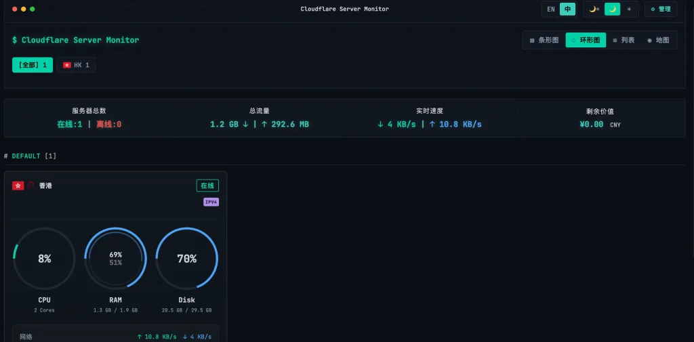
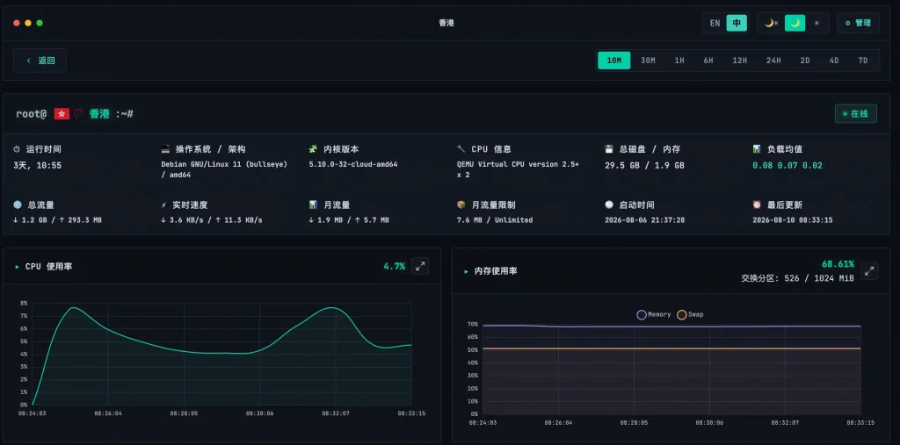
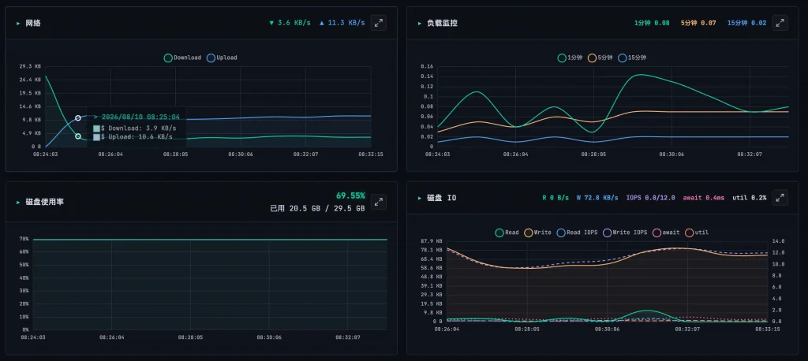
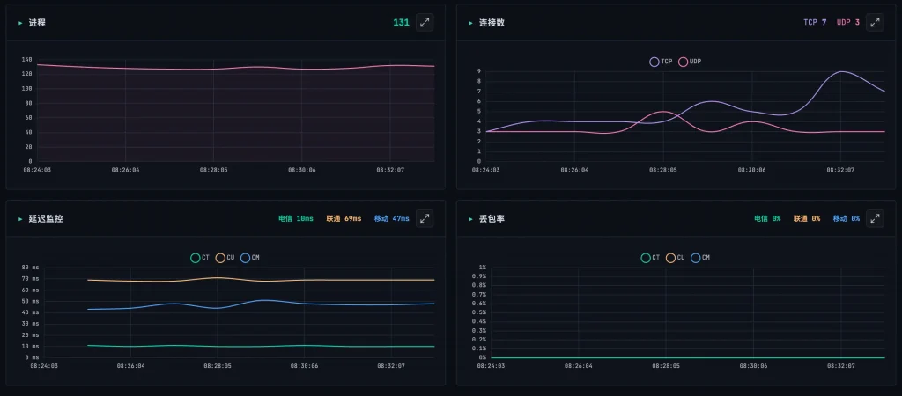

很多站长都有一个痛点：

服务器到底稳不稳定？

CPU 有没有爆？

内存是不是快满了？

硬盘还能撑多久？

网站访问慢，到底是程序问题，还是服务器问题？

以前很多人会选择安装宝塔、1Panel、Prometheus 等大型监控系统。

但是问题来了：

❌ 安装复杂  
❌ 占用资源  
❌ 配置麻烦  
❌ 小服务器根本跑不动

特别是一些只有 **1核1G、2核2G 的 VPS**，安装一堆监控服务，反而拖慢服务器。

有没有一种：

✅ 简单  
✅ 免费  
✅ 开源  
✅ 轻量  
✅ 浏览器直接查看

的服务器监控方案？

今天分享一个 GitHub 上的开源项目：

🔥 **CF-Server-Monitor**

一个专为 Cloudflare 生态打造的服务器状态监控面板。

---

## 🌟 它解决了什么问题？

很多个人站长都有这样的经历：

晚上睡觉前网站还正常。

第二天起来：

“网站怎么打不开了？”

登录服务器：

CPU 100%

内存爆满

磁盘满了

服务停止

但是你完全不知道什么时候发生的。

服务器监控的意义，就是：

> 在问题发生之前，提前发现风险。

CF-Server-Monitor 就是帮助你实时了解服务器健康状态。

---

# 🖥️ 一个页面，看懂服务器所有情况

打开面板后，你可以看到：

## 1️⃣ CPU 实时监控

查看：

- CPU 使用率
- CPU 核心数量
- 实时变化曲线

比如：

服务器平时 CPU 只有 5%

突然升到 90%

你马上就知道：

是不是：

- 网站被攻击？
- 程序异常？
- 爬虫太多？

不用登录 SSH 查询。

直接打开网页即可。

---

# 2️⃣ 内存 RAM 监控 💾

内存是 VPS 最容易出现问题的地方。

尤其：

- WordPress
- Docker
- AI 服务
- 数据库

很容易吃满内存。

它可以实时显示：

✅ 当前内存使用率  
✅ 已使用容量  
✅ 总内存大小  
✅ Swap 交换分区

例如：

1.9GB 内存：

已经使用：

1.3GB

占比：

68%

你可以提前优化。

---

# 3️⃣ 磁盘空间监控 📀

很多网站打不开，不一定是程序问题。

可能只是：

服务器硬盘满了。

CF-Server-Monitor 可以查看：

- 总磁盘容量
- 已使用空间
- 使用百分比

比如：

29.5GB 磁盘

已经用了：

20.5GB

提前清理：

- 日志
- 缓存
- Docker 镜像

避免服务器突然挂掉。

---

# 4️⃣ 网络流量监控 🌐

网站访问速度异常？

看看网络。

支持查看：

⬇ 下载速度

⬆ 上传速度

可以发现：

- 是否有人大量下载
- 是否流量异常
- 是否遭遇攻击

---

# 5️⃣ 系统信息展示 🔥

服务器信息全部集中展示：

包括：

✅ 操作系统  
✅ CPU 型号  
✅ 内核版本  
✅ 架构信息  
✅ 运行时间  
✅ 启动时间

不用输入 Linux 命令：

打开网页全部看到。

---

# 6️⃣ 负载监控

服务器负载非常重要。

比如：

CPU 使用率正常。

但是负载很高。

说明：

可能大量任务排队。

它支持：

- 1分钟负载
- 5分钟负载
- 15分钟负载

帮助判断服务器压力。

---

# 7️⃣ 网络延迟检测 🚄

对于：

- 网站
- API
- 游戏服务器
- 海外 VPS

延迟非常重要。

可以查看：

不同线路：

- 电信
- 联通
- 移动

访问延迟。

方便判断：

服务器位置是否适合你的用户。

---

# 8️⃣ 丢包率检测 📡

服务器稳定性的重要指标。

如果：

延迟高

- 丢包

那么用户访问体验一定差。

它可以实时查看：

线路丢包情况。

---

# 9️⃣ 连接数统计

查看：

TCP

UDP

连接数量。

可以发现：

异常连接。

例如：

突然大量 TCP：

可能：

- 网站攻击
- 爬虫暴增
- 服务异常

---

# 🔥 为什么推荐这个项目？

相比传统监控工具：

## Prometheus

功能强大。

但是：

❌ 配置复杂  
❌ 学习成本高

## 宝塔监控

方便。

但是：

❌ 依赖面板  
❌ 占用资源

## CF-Server-Monitor

优势：

✅ 轻量级  
✅ 开源免费  
✅ 界面漂亮  
✅ 数据直观  
✅ 适合个人 VPS  
✅ Cloudflare 用户友好

---

# 💡 适合哪些人？

非常适合：

👨‍💻 个人站长

管理：

- WordPress
- 博客
- 导航站

---

🖥️ VPS 玩家

拥有：

- 香港 VPS
- 美国 VPS
- 日本 VPS

随时查看状态。

---

🚀 开源项目作者

部署：

- API 服务
- Demo 网站
- SaaS 项目

需要实时知道服务器情况。

## 相关截图：

## 搭建教程：

**第一步**：Fork 项目  
点击右上角 Fork 按钮，将项目 Fork 到你的 **GitHub 账户**。

**第二步**：新建 **Cloudflare Workers**  
登录 Cloudflare 控制台  
进入 **Workers & Pages**  
点击 **Create application**  
选择 **Continue with GitHub**（第一次使用需要连接 GitHub 账户），选择本项目  
**Project Name**填写：cf-server-monitor  
**Build command** 填写：**npm run build:frontend**  
**Deploy command** 保留默认值：**npx wrangler deploy**  
点击 **Deploy**，成功会在底部显示✨ Success! Build completed.

**第三步**：配置环境变量  
在当前**Workers & Pages**页面，点击 **Settings**  
在**Variables and secrets找到API_SECRET**，点右侧编辑，填写密码（建议使用随机数,不要包含特殊字符比如%），点**Deploy**保存部署，等待30秒左右部署完成

**第四步**：绑定自定义域名，后台管理与设置**访问后台地址/admin,** 默认用户名**admin**，默认密码是刚才**API_SECRET**的值。

### **🔗项目地址：[https://github.com/huilang-me/CF-Server-Monitor](https://github.com/huilang-me/CF-Server-Monitor)**

---

> 本文转载整理自 [Ai星码博客](https://aixmb.com/788.html)，版权归原作者所有。

