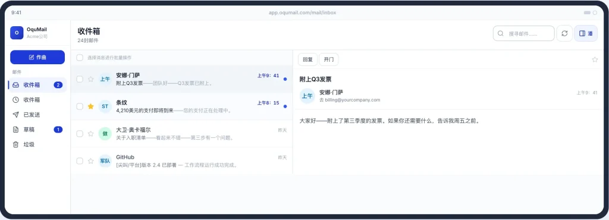
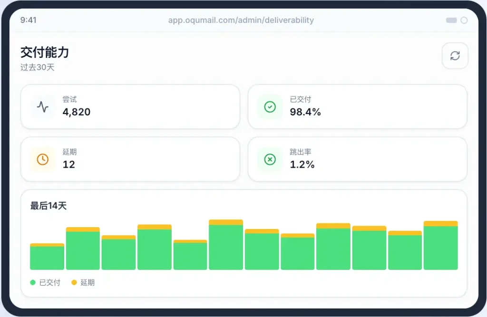
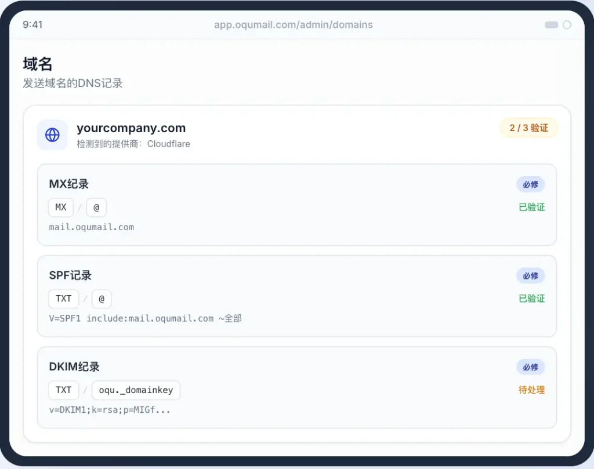
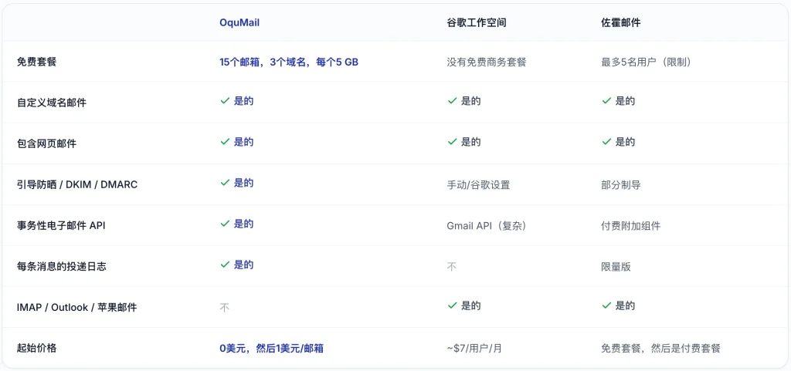

很多站长、开发者都会遇到一个问题：

手里有一个域名，除了搭建网站之外，还能做什么？

其实，一个域名不仅可以用于网站，还可以打造属于自己的邮箱系统，让项目看起来更加专业。

今天分享一个非常实用的平台：

🔥 **OquMail**

一个支持自定义域名的免费邮箱服务平台。

---

## 📌 OquMail 首页展示

---

# 🌟 OquMail 有什么特点？

✅ 免费使用  
✅ 支持自定义域名  
✅ 支持多个域名管理  
✅ 简洁美观的网页邮箱界面  
✅ 支持 IMAP 邮件客户端  
✅ 支持邮件投递统计  
✅ 支持 SPF、DKIM 等安全配置  
✅ 支持邮件 API  
✅ 适合个人项目和小团队使用

---

# 📬 简洁的网页邮箱体验

OquMail 提供了直观的网页邮箱界面。

无需安装复杂软件，

打开浏览器即可：

📩 查看邮件  
✉️ 发送邮件  
🔍 搜索邮件  
📂 管理邮件内容

---

# 🌐 域名管理功能

使用自己的域名，

通过简单的 DNS 配置即可完成绑定。

平台支持检测：

✅ MX 记录  
✅ SPF 记录  
✅ DKIM 记录

帮助提升邮件安全性，

提高邮件投递成功率。

【插入图片：域名管理页面截图】

---

# 📱 支持 IMAP，多平台管理

除了网页端之外，

OquMail 还支持 **IMAP 协议**。

可以连接：

✅ 手机邮箱客户端  
✅ 桌面邮箱软件  
✅ 第三方邮件工具

根据自己的习惯管理邮件，

更加灵活方便。

### 收邮件

查看收件箱——你的应用称之为“incoming ing”或“IMAP”。

邮件服务器：mail.oqumail.com

端口：993

如果你的应用要求安全类型，**选择SSL或TLS**。

你的域名邮箱：XXX@XXX.com

每个人的全地址，例如：sales@yourcompany.com

密码：邮箱创建时设置的密码

### 发送邮件

回复和新消息——你的应用称为“发信”或“SMTP”。

邮件服务器：mail.oqumail.com

通常和收发是一样的。

端口：587

**这里选择STARTTLS或TLS——该端口不要使用SSL**。

如果发送失败，请参见下面的故障排除。

你的域名邮箱

地址和收货地址相同。

密码：每个人都使用自己的邮箱地址和密码——而不是你的管理员登录。

---

# 📊 邮件投递统计

发送邮件后，

你还可以查看邮件投递情况。

包括：

✅ 已发送数量  
✅ 投递成功率  
✅ 延迟情况  
✅ 失败记录

方便了解邮件是否正常送达。

---

# 🔐 邮件安全配置

邮件系统最重要的问题之一：

就是安全和可信度。

OquMail 支持：

✅ SPF  
✅ DKIM

帮助验证邮件来源，

减少邮件进入垃圾箱的概率。

---

# 💰 免费方案

OquMail 提供免费计划：

✅ 最多 15 个邮箱（每个用户发250条/天）  
✅ 支持 3 个域名  
✅ 每个邮箱 5GB 存储空间  
✅ 支持网页邮箱  
✅ 支持自定义域名邮箱

对于：

个人站长、

独立开发者、

小型项目，

基本可以满足日常需求。

---

# 💡 适合哪些人？

## 👨‍💻 独立开发者

管理自己的项目，

拥有更加专业的联系方式。

---

## 🌐 网站站长

给自己的网站增加更多完整功能。

---

## 🚀 开源项目作者

方便项目交流和用户反馈。

---

# 为什么推荐 OquMail？

传统邮箱服务：

❌ 价格较高  
❌ 功能限制多  
❌ 自定义域名成本高

而 OquMail：

✅ 免费  
✅ 简单  
✅ 支持域名管理  
✅ 功能完整

让普通用户也可以轻松拥有自己的域名邮箱服务。

---

# 🌈 总结

现在，一个域名不仅可以搭建网站，

还可以扩展更多实用服务。

OquMail 通过简单配置，

让你快速拥有一个属于自己的邮箱管理平台。

如果你手里有闲置域名，

这个项目值得收藏。📮

---

### **🔗项目地址：** [https://oqumail.com](https://oqumail.com/)

### 美国地址生成器：[https://address.aixmb.cn](https://address.aixmb.cn)
