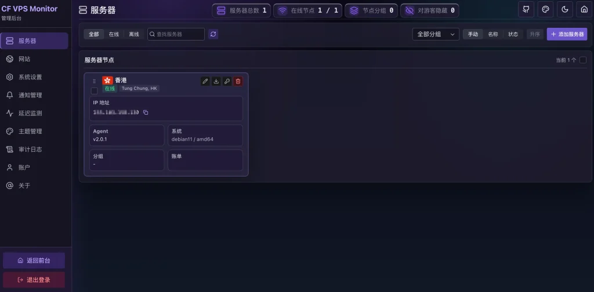
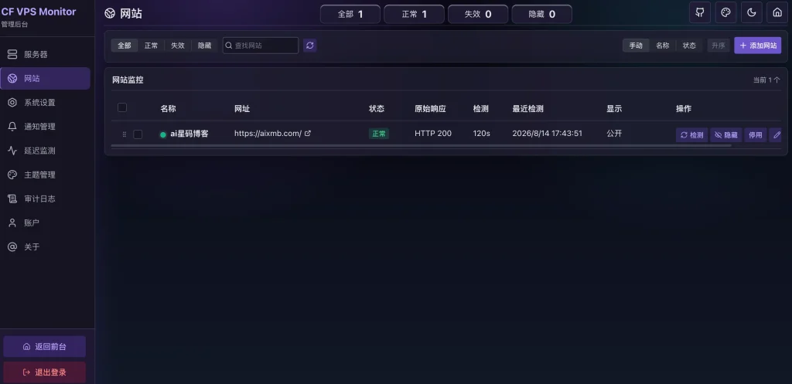
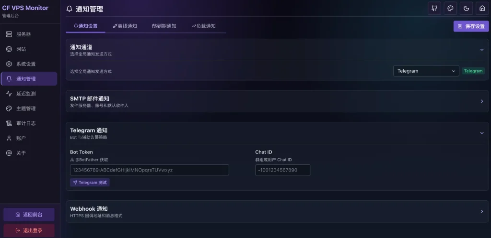
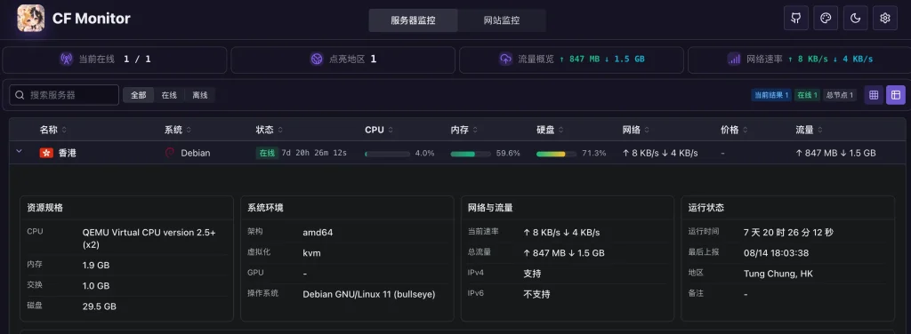

VPS 多了以后，最头疼的不是部署，而是**监控和管理**。

CPU 有没有跑满？  
内存是不是快满了？  
硬盘还有多少空间？  
网站还能不能正常访问？  
服务器离线了有没有人通知？

每天登录 SSH 一个个检查，确实太麻烦了。😵

今天分享一个开源项目：**CF VPS Monitor**。

它是一款轻量级 **VPS 服务器监控面板**，通过 Cloudflare Workers + Durable Objects + Supabase + Go Agent，实现服务器、网站和网络状态的统一监控。

## 🖥️ VPS服务器监控

可以实时查看：

- CPU、GPU
- 内存、Swap
- 磁盘
- 系统负载
- 网络速度
- 月度流量
- 温度
- IPv4 / IPv6
- TCP / UDP连接
- 进程数量
- VPS账单和到期时间

服务器多的时候，打开一个面板就能全部查看。📊

**【此处插入服务器监控截图】**

## 🌐 网站监控

除了监控 VPS，还可以监控网站。

支持：

- HTTP / HTTPS
- GET / HEAD
- TCP检测
- HTTP状态码
- 超时时间
- 检测间隔
- 手动检测

所以即使服务器在线，也能及时发现网站异常。🚨

**【此处插入网站监控截图】**

## 🔔 异常自动通知

支持多种通知方式：

✈️ Telegram  
📧 SMTP Email  
🔗 Webhook

服务器离线、网站异常、负载过高等情况，可以自动发送通知。

**【此处插入通知设置截图】**

## ⚡ Ping延迟监控

支持 ICMP、TCP、HTTP Ping，可以查看延迟历史，还能指定不同服务器节点进行检测。

对于拥有香港、日本、美国等多个 VPS 节点的用户，非常实用。🌏

## ☁️ Cloudflare架构

项目使用：

**Cloudflare Workers**：前端、API、实时连接、定时任务

**Durable Objects**：实时状态协调

**Supabase Postgres**：配置和历史数据

**Go Agent**：服务器数据采集

同时采用动态采样策略，有人查看时提高采集频率，无人查看时降低频率，更节省资源。

## 🎯 适合谁？

如果你有多台 VPS、多个网站，或者喜欢折腾 Cloudflare 和开源项目，这个 VPS 监控面板非常值得收藏。

**服务器监控 + 网站监控 + Ping监控 + 自动告警 + 后台管理，一套面板全部搞定。** 🚀

## 相关截图：

### **🔗项目地址：[https://github.com/kadidalax/cf-vps-monitor](https://github.com/kadidalax/cf-vps-monitor)**

### **🔗备用地址：[https://github.com/aixmbcom/cf-vps-monitor](https://github.com/aixmbcom/cf-vps-monitor)**
