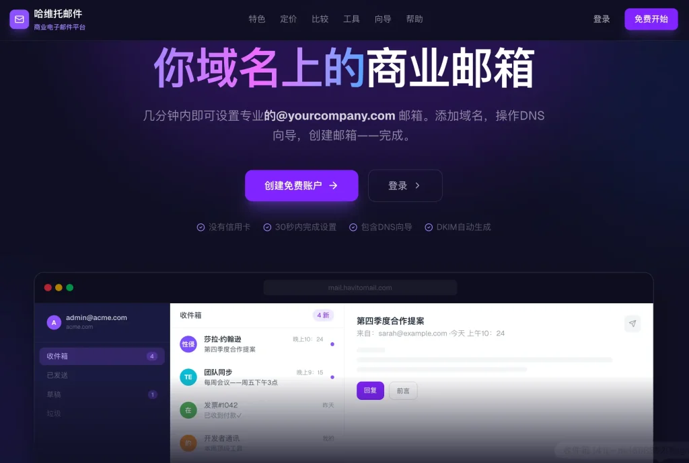
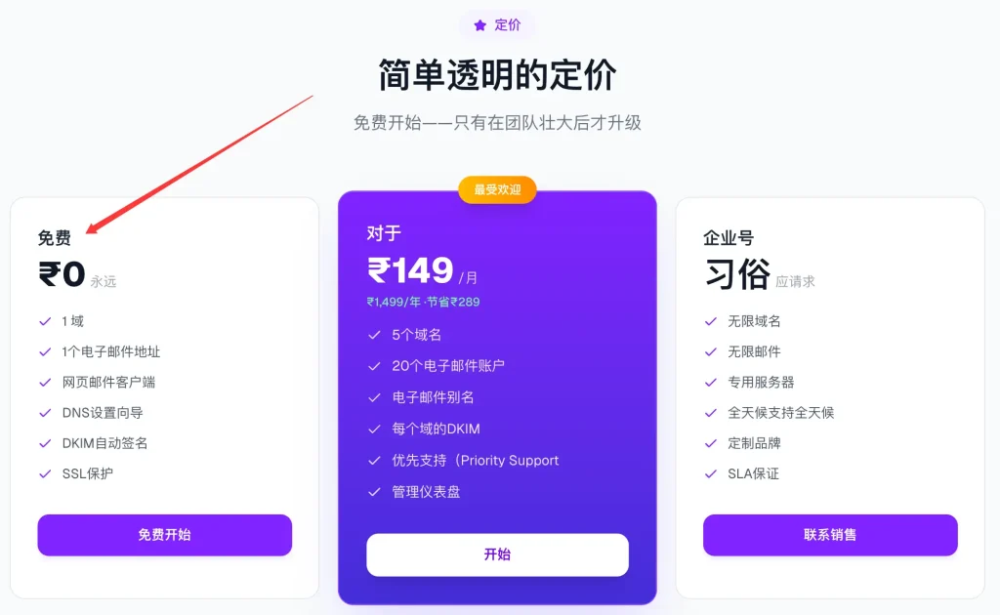

今天分享一个比较实用的企业邮箱服务——**HavitoMail**。

它主打的就是：**自己的域名 + 企业邮箱 + 免费开始使用。**

## 💻 几分钟就能搭好

HavitoMail 提供 DNS 设置向导，不需要自己研究复杂的邮箱配置。

添加域名后，会引导配置：

- MX
- SPF
- DKIM
- DMARC

并且提供实时验证，配置完成后就可以创建自己的域名邮箱。

---

## 🆓 免费版真的可以长期使用

它目前提供 **Free 免费方案**：

✅ 1个域名  
✅ 1个邮箱地址  
✅ 网页邮箱  
✅ DNS设置向导  
✅ DKIM自动签名  
✅ SSL安全连接  
✅ IMAP / SMTP

而且官方标注为 **₹0 / forever**，没有信用卡要求，也不是短期试用。

对于个人站长、独立开发者、小项目来说，已经够用了。

---

## 📧 不只是网页邮箱

如果你不喜欢网页版，也可以接入常见邮箱客户端。

支持标准：

**IMAP + SMTP**

可以连接：

📱 iPhone / Android  
💻 Outlook  
🍎 Apple Mail  
🦊 Thunderbird  
📨 Gmail 邮箱客户端

也就是说，手机、电脑都可以正常收发。

---

## 🔐 SPF、DKIM、DMARC都有

做企业邮箱，最怕什么？

**邮件发出去直接进垃圾箱。** 😭

HavitoMail 提供 SPF、DKIM、DMARC 配置引导，并且可以自动生成 DKIM 签名。

这些配置可以帮助验证邮件来源，降低域名被冒用以及邮件被错误判定为垃圾邮件的风险。

---

## 🔒 SSL / TLS 加密

邮箱登录、SMTP、IMAP以及网页端连接都支持 SSL/TLS 加密。

对于经常处理：

💰 订单  
📄 合同  
👤 客户信息  
📧 商务邮件

的人来说，这一点还是很重要的。

---

## 👥 团队也能用

如果后面需要多人使用，可以升级 Pro。

目前 Pro 方案：

**₹149 / 月**

包含：

✅ 5个域名  
✅ 20个邮箱账号  
✅ 邮箱别名  
✅ 每个域名独立 DKIM  
✅ 管理后台  
✅ 优先支持

也就是说，不需要按照每个员工单独购买账号。

---

## 📨 邮箱功能也比较完整

内置 Webmail，可以直接：

✉️ 写邮件  
↩️ 回复  
📎 添加附件  
🔎 搜索邮件  
📂 文件夹管理  
📨 批量操作  
📤 发送和接收邮件

不用额外安装邮箱客户端，浏览器打开就能使用。

---

## 🏢 适合哪些人？

如果你是：

👨‍💻 独立开发者  
🌐 网站站长  
🚀 创业者  
🛒 电商卖家  
🏢 小型团队  
📱 SaaS项目  
📝 博客作者

拥有一个

**@你的域名.com**

邮箱，会比普通免费邮箱看起来更加专业。

---

## ⭐ 总结

HavitoMail 的核心其实很简单：

**自己的域名 → 企业邮箱 → DNS自动引导 → Webmail + IMAP/SMTP → 免费开始。**

而且免费方案已经包含：

**1个域名 + 1个邮箱 + Webmail + DNS向导 + DKIM + SSL + IMAP/SMTP。**

如果你手里正好有一个闲置域名，不妨试试看。

### **🔗项目地址:[https://havitomail.com](https://havitomail.com)**
