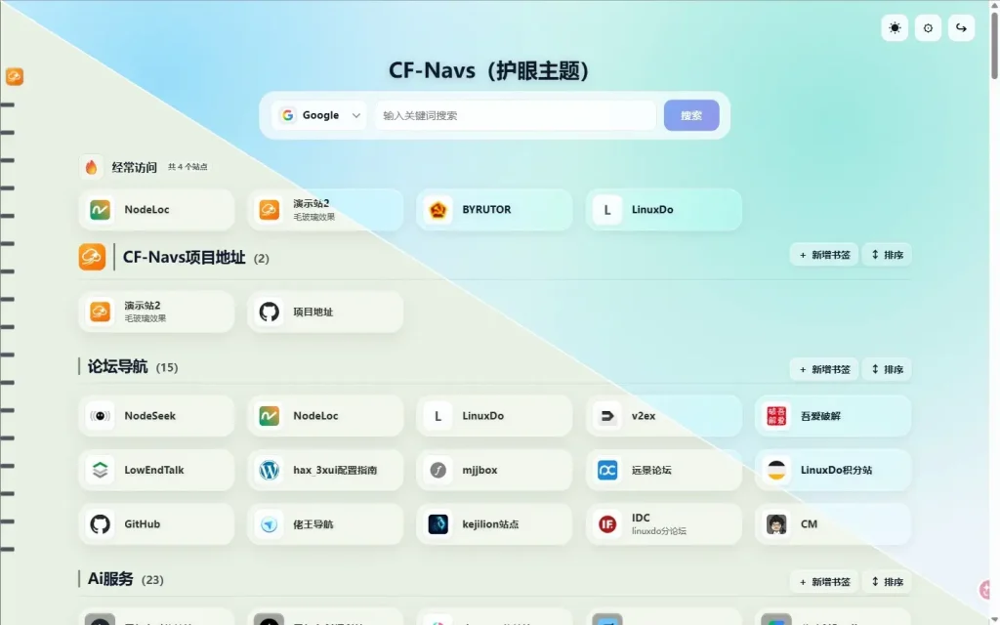
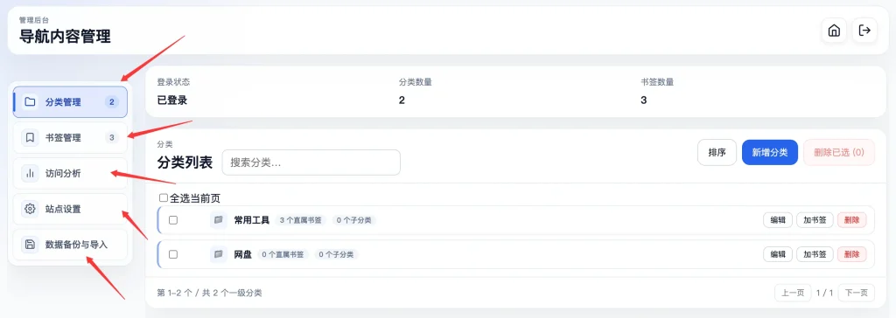
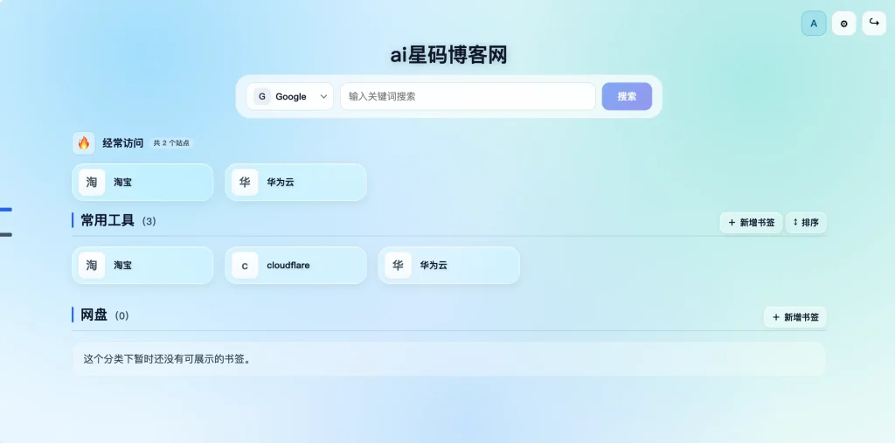
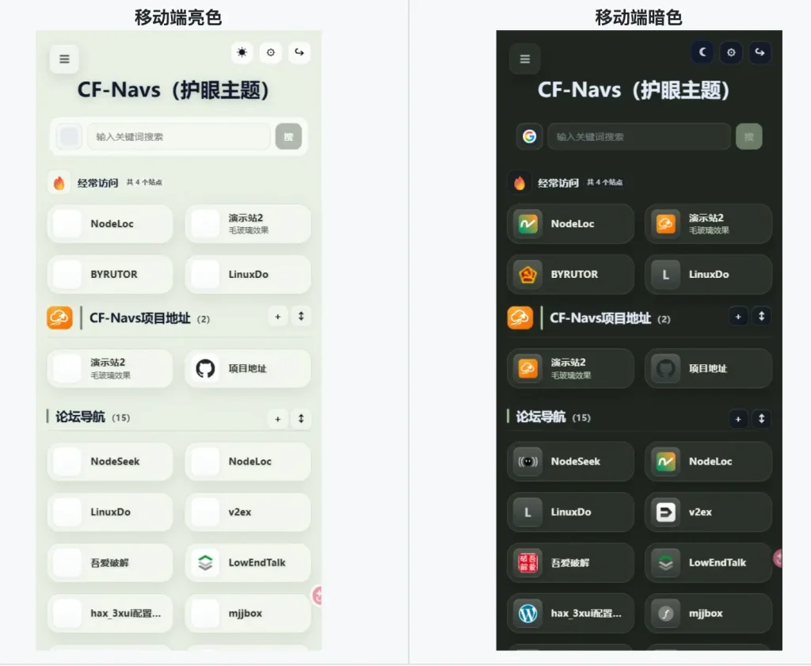

浏览器收藏夹越来越乱，常用网站找半天？

想搭一个**属于自己的导航网站**，又不想买服务器？

可以看看这个开源项目：**CF-Navs**。

它是一款运行在 **Cloudflare Workers** 上的轻量级个人导航面板，前端、API、D1 数据库和 KV 会话都可以放在 Cloudflare 上，不需要自己准备 VPS。

## 🧭 一个页面，管理所有网站

可以按照自己的习惯创建分类，例如：

🤖 AI工具  
💻 开发工具  
☁️ Cloudflare  
📦 GitHub  
🎨 设计工具  
📚 学习资源  
🎬 视频网站

然后把常用网站全部放进去。

支持**搜索、分类、排序、拖拽管理**，找网站会方便很多。

## 🎨 颜值也可以自己折腾

不喜欢千篇一律的导航页面？

CF-Navs 提供 **22套内置主题**，支持：

🌞 亮色 / 🌙 暗色  
🖼️ 自定义背景  
🌫️ 背景遮罩  
📐 卡片尺寸  
✨ 透明度  
🔤 图标大小  
🧭 左侧 / 顶部导航

完全可以按照自己的喜好打造一个导航站。

## 🔎 搜索功能也很实用

除了搜索自己的书签，还支持外部搜索引擎。

网站图标也有多种方式：

🌐 Favicon  
🎨 Iconify  
🖼️ 图片  
🔤 文字  
😀 Emoji

不用再一个个找图标。

## 💾 换导航站也不用重新整理

如果以前使用过其他导航工具，也不用从零开始。

CF-Navs 支持：

📄 JSON 备份 / 恢复  
☀️ Sun-Panel 数据导入  
🌐 浏览器书签 HTML 导入

换电脑、换服务器或者迁移数据都方便不少。

## 🔐 安全功能也考虑到了

作为一个自己部署的导航站，后台安全当然不能马虎。

项目提供：

🔑 PBKDF2 密码哈希  
🍪 HttpOnly Session Cookie  
🛡️ CSRF 防护  
🚫 登录失败限流

不是简单做个静态导航页面。

## ⚡ 为什么推荐 Cloudflare？

它的架构非常适合喜欢 Cloudflare 的人：

☁️ **Cloudflare Workers**：运行应用和 API  
🗄️ **D1**：保存分类、书签和设置  
🔐 **KV**：保存管理员会话

而且项目支持通过 Cloudflare 控制台导入 GitHub 仓库进行部署。

## 🎯 最适合这些人

如果你：

👨‍💻 收藏了一堆开发网站  
🤖 经常使用 AI 工具  
🌐 想搭自己的网址导航  
☁️ 喜欢 Cloudflare 免费项目  
🛠️ 想自己部署一个导航站

CF-Navs 值得收藏。

**它解决的其实就是一个很简单的问题：**

> 网站越来越多，但我们总需要一个地方，把真正有用的网站整理起来。

而且这次，**导航站不用买 VPS，直接跑在 Cloudflare 上。** 🚀

## 相关截图

### **电脑端**

### **手机端：**

## **部署文字教程：**

🚀 CF-Navs 部署方法

整个部署过程不需要 VPS，直接使用 Cloudflare Workers + D1 + KV 即可。

① Fork 项目

先 Fork CF-Navs 仓库，并确认默认分支是 main。

② 导入 Cloudflare

进入：Cloudflare → Workers & Pages → 创建应用程序 → 导入存储库→ 授权 GitHub 后选择刚刚 Fork 的仓库。

构建配置填写：

生产分支：**main**  
根目录：**/**  
构建命令：**npm run build**  
部署命令：**npx wrangler deploy**

然后完成第一次生产部署。

③ 配置 **SETUP_TOKEN** 🔐

第一次部署完成后，在 Worker：

设置 → 仪表和钥匙 → 生产环境

添加一个名为：**SETUP_TOKEN** 的密钥（**值自定义长度最好复杂些**）（Secret）。

⚠️ 注意：一定要添加为“**密钥**”，不要添加成普通文本变量。

保存 Secret 后重新部署同一个 main 生产部署：可以在 Deployments 页面对最近一次生产部署执行 Retry/Redeploy，也可以向 main 推送一个新提交。不要只保存 Secret 后直接访问 /install，必须先让新的部署读取到 Secret。

④ 完成初始化

打开部署后的 Workers 地址，在网址后面加：/install

例如：

**https://你的项目.workers.dev/install**

输入刚刚设置的 **SETUP_TOKEN**，创建管理员账号和密码。

安装完成后，就可以正常登录导航后台了。🎉

⑤ 绑定自己的域名 🌐

如果想使用自己的域名，可以进入：

Workers → 域和路由 → 添加自定义域

绑定完成并确认可以正常访问后，再根据自己的需求关闭 workers.dev 地址。

**⚠️ 一个特别容易踩坑的地方**

不要设置完 SETUP_TOKEN 后直接访问 /install。

一定要：

添加 Secret → 保存 → 重新部署 → 再访问 /install

否则新配置可能还没有被当前生产环境读取。

另外，初始化完成以后记得删除或轮换 SETUP_TOKEN，因为安装完成后已经不再需要这个令牌了。

### **🔗项目地址:[https://github.com/lbjxr/CF-Navs](https://github.com/lbjxr/CF-Navs)**

### **🔗备用地址:[https://github.com/aixmbcom/CF-Navs](https://github.com/aixmbcom/CF-Navs)**
