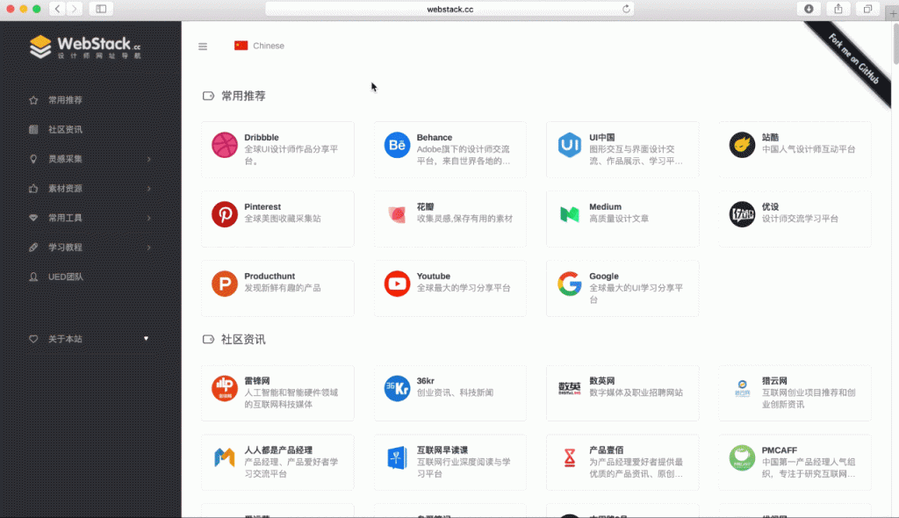

你有没有这种感觉？

收藏的网站越来越多👇

🤯 AI工具找不到  
🤯 常用网站太分散  
🤯 浏览器收藏夹乱成一团  
🤯 想做个网站，却觉得服务器、代码太麻烦

其实，现在搭一个网站没你想象中那么难。

今天分享一个宝藏开源项目：

🔥 **WebStackPage**

一个开源网址导航模板。

---

## 🌐 它能干什么？

简单来说：

就是帮你快速搭建一个属于自己的“网站导航中心”。

可以做：

🤖 AI工具导航  
💻 程序员资源导航  
🎨 设计素材导航  
📚 学习网站导航  
🛒 电商工具导航  
🏢 企业内部网址入口

把各种优质资源整理起来，用户打开网站就能找到需要的工具。

---

## ✨ 为什么值得玩？

✅ 开源免费  
✅ 页面简洁漂亮  
✅ 支持手机电脑访问  
✅ 分类清晰，方便管理  
✅ 不需要从零开发

最重要的是：

🔥 可以部署到 Cloudflare Pages

不用买服务器。

不用维护环境。

代码上传后，自动部署。

真正做到：

“零成本拥有一个网站”。

---

## 💰 还能赚钱吗？

当然可以。

一个有流量的网址导航，可以：

💵 接入广告  
💵 出售推荐位  
💵 做工具推广  
💵 获取搜索流量

比如：

“AI工具大全”

“免费办公工具”

“设计资源导航”

这些方向都有长期需求。

---

## 🚀 普通人怎么玩？

不用一开始做很大。

选择一个细分方向：

👇

AI导航

↓

每天收集几个优质工具

↓

优化 SEO

↓

慢慢积累流量

一个小网站，也可能变成你的长期资产。

---

现在互联网不缺网站。

缺的是：

帮用户找到好东西的人。

如果你一直想做一个自己的站点，这个项目值得收藏 ❤️

**本期视频将详细讲解 WebStack 部署到 Cloudflare Pages 的两种方法，以及它们各自的优缺点。**

---

# 方法一：Upload your static files 📂

也就是：

**直接上传静态文件部署**

适合：

✅ 第一次建站的小白  
✅ 只想快速搭建网站  
✅ 不想学习代码和 GitHub 的用户

操作非常简单：

下载 WebStack 文件  
⬇️  
上传到 Cloudflare Pages  
⬇️  
等待部署完成  
⬇️  
网站直接上线 🎉

### 优点：

✨ 操作简单，几分钟完成  
✨ 不需要 GitHub  
✨ 不需要配置开发环境  
✨ 非常适合快速体验

### 缺点：

⚠️ 后续更新比较麻烦  
⚠️ 修改内容需要重新上传  
⚠️ 不适合长期维护运营

如果只是做一个个人导航页，这种方式已经够用了。

---

# 方法二：Cloudflare Pages + GitHub 🚀

这种方式更适合想长期运营网站的人。

部署流程：

GitHub 仓库  
⬇️  
连接 Cloudflare Pages  
⬇️  
自动完成部署

以后更新网站：

修改代码

↓

提交 GitHub

↓

Cloudflare 自动更新网站

非常方便。

---

## 优点：

🔥 自动部署，省心省力  
🔥 修改网站更加方便  
🔥 支持版本管理  
🔥 适合长期运营  
🔥 方便团队协作

特别适合：

🤖 AI工具导航  
💻 资源导航站  
📚 行业工具大全  
💰 SEO流量网站  
🔥 广告变现项目

---

## 缺点：

⚠️ 第一次设置需要一点学习成本  
⚠️ 需要了解 GitHub 基础操作  
⚠️ 新手刚开始可能需要花一点时间配置

但配置完成后，后面维护会非常轻松。

---

# 🤔 那么到底怎么选择？

如果你只是：

✔ 测试项目  
✔ 做个人收藏导航  
✔ 想快速上线

选择：

👉 **Upload your static files**

---

如果你想：

✔ 长期运营网站  
✔ 获取 SEO 流量  
✔ 接入广告赚钱  
✔ 打造自己的资源站

选择：

👉 **Cloudflare Pages + GitHub**

---

很多人觉得做网站很难。

其实现在：

一个开源项目 + Cloudflare Pages，

不用服务器，也可以拥有自己的互联网入口。

🚀 如果你也想了解 Cloudflare 网站部署全过程，一定要看到最后，手把手带你完成部署！

### 相关截图：

### **🔗项目地址:[https://github.com/WebStackPage/WebStackPage.github.io](https://github.com/WebStackPage/WebStackPage.github.io)**
