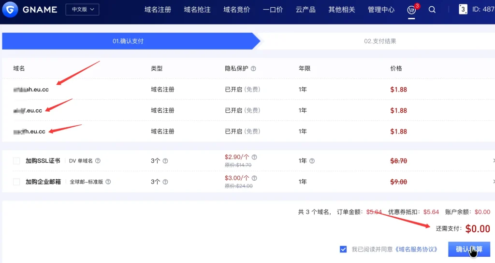
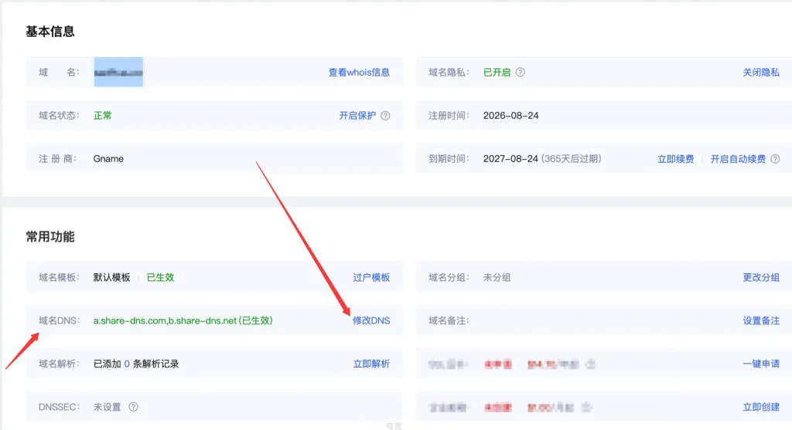

如果你最近刚好想折腾个人博客、导航站、项目演示站，或者只是想给自己的小项目弄一个好记的域名，那么今天这个可以留意一下。

之前给大家分享过免费的 ****eu.org 域名****，不过它有一个比较明显的问题：域名比较长，而且注册后还需要等待审核。

这次发现的这个就简单多了。

### 👉 **.eu.cc免费域名**

最大的特点就是：**注册门槛低、域名比较短，而且普通账号就可以免费注册。**

🌐 这个域名有什么特别？

.eu.cc本质上是一个域名后缀。

比如：

abc.eu.cc

blog.eu.cc

ai.eu.cc

对于个人博客、工具站、导航站、开源项目展示页来说，长度还是比较舒服的。

更重要的是，目前 GNAME 正在提供 `.eu.cc` 的免费注册活动，**普通用户可以获得 3 个免费注册名额**，不需要额外完成复杂任务。

所以如果你只是想体验一下免费域名，还是挺方便的。

### 🎁 免费注册是怎么实现的？

这里需要注意一个细节。

它并不是直接显示“价格为 0 元”，而是通过**全额抵扣优惠券**的方式实现免费注册。

进入官方的免费注册活动页面后，领取对应的 `.eu.cc` 抵扣券，然后选择符合条件的域名注册即可。

也就是说：

**正常查询 → 领取免费额度 → 使用抵扣券 → 0 元注册**

目前普通账号最多可以免费注册 3 个 .eu.cc 域名。

⚠️ 有一个坑，一定要提前知道

并不是所有你喜欢的域名都能够免费注册。

一些比较特殊的域名会被划分为**溢价域名**，例如：

* 双字母域名  
* 三字母域名  
* 一些品牌名称  
* 热门行业词  
* 其他注册局定义的溢价域名

这些域名不能直接使用免费抵扣券。

所以看到一个特别漂亮的短域名，不要马上以为可以白嫖，**先查询价格再决定。**

官方也明确说明了这一点。

### 🔄 免费域名可以一直用吗？

这也是很多人最关心的问题。

目前活动规则支持免费续费，但有一个非常重要的时间限制：

**必须进入域名到期前 90 天的时间范围，才能申请免费续费。**

而且千万别直接去“我的域名”里面续费。

官方规定：

> 免费续费必须从“免费注册”活动页面提交。

如果你在普通域名管理页面续费，或者开启自动续费，并不能享受这项免费续费活动。

所以建议大家注册之后，把到期时间记下来。

到了续费周期，再去活动页面操作。

### ☁️ 能不能搭配 Cloudflare？

可以。

如果你平时喜欢折腾 Cloudflare，那么这个域名也比较适合拿来做一些个人项目。

例如：

博客、导航站、个人主页、在线工具、项目展示页、短链接站、测试站等。

注册完成后，可以按照正常域名的方式进行 DNS 管理，也可以根据自己的需求接入 Cloudflare。

这样一来，免费域名 + Cloudflare 免费服务，就可以组合出一个基本零成本的小网站。

### 💡 我觉得它更适合哪些人？

如果你是：

👉 想搭一个个人博客

👉 想做一个自己的导航站

👉 经常测试开源项目

👉 喜欢折腾 Cloudflare

👉 想给自己的项目准备几个备用域名

👉 不想一开始就花钱买域名

那么 .eu.cc 可以先收藏起来。

当然，如果你准备做一个长期商业项目，我还是更建议使用自己购买的正规顶级域名。

免费域名最大的优势是降低试错成本，而不是完全替代付费域名。

### 📌 最后总结

这次这个 .eu.cc，我认为最大的优势就是：

短 + 免费 + 注册简单 + 支持免费续费。

普通账号目前有 **3 个免费注册名额**，但要注意避开品牌词和溢价域名。

另外最容易忘记的一点就是：

****续费一定要在到期前 90 天内，并且必须从“免费注册”活动页面提交**。**

如果你准备拿它搭个人博客、导航站或者测试项目，可以先去看看有没有自己喜欢的域名。

### **🔗项目地址:[https://www.gname.net](https://www.gname.net)**

### 美国地址生成器：[https://address.aixmb.cn](https://address.aixmb.cn)

---

> 本文转载整理自 [Ai星码博客](https://aixmb.com/871.html)，版权归原作者所有。

