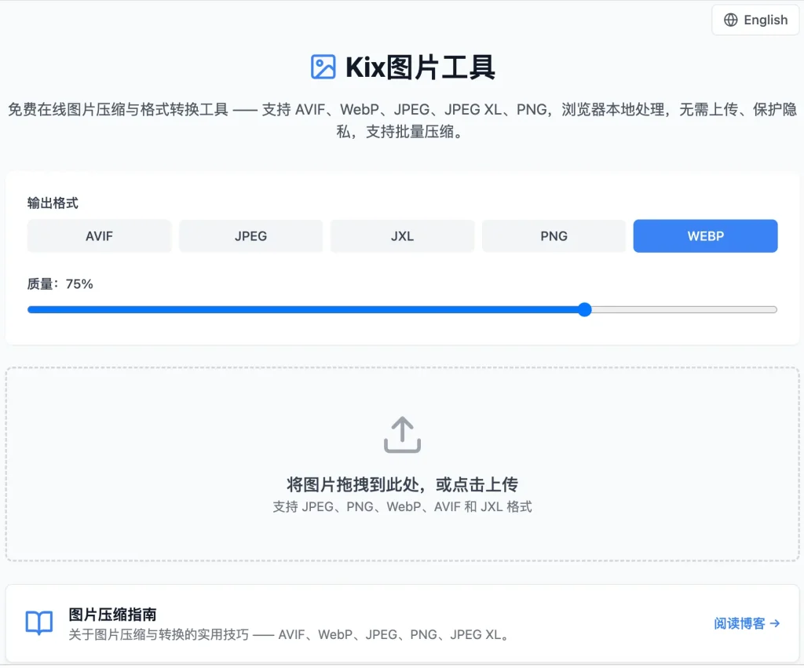
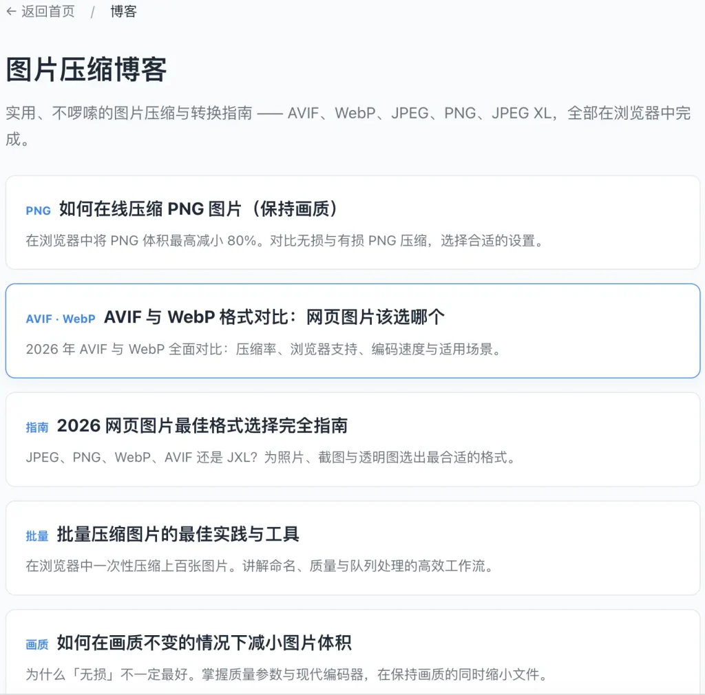
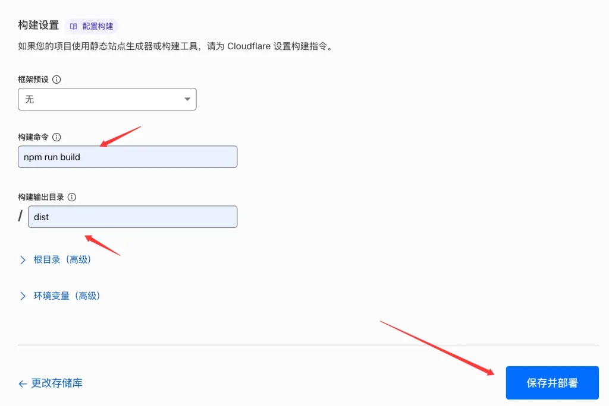

还在为图片太大、格式不兼容发愁？📷

这个 **Kix 图片工具**，把常用的图片压缩和格式转换功能一次性集成了。

### 🖼️ 能做什么？

✅ JPG / PNG / WebP / AVIF / JXL 格式转换  
✅ 在线图片压缩  
✅ 自定义图片质量  
✅ 支持批量压缩  
✅ 拖拽图片即可处理  
✅ 浏览器本地处理，无需上传  
✅ 更注重用户隐私 🔒  
✅ 中英文双语支持

尤其适合搭建自己的**在线图片压缩工具站**。

---

## 💰 还能做成一个副业项目？

如果你一直在寻找一些**低成本、可长期运营的互联网副业**，这种在线工具其实可以研究一下。

项目本身可以通过 **Cloudflare** 部署，搭配自己的域名，再接入第三方广告。

简单来说：

**开源项目 → Cloudflare 部署 → 图片工具 → 第三方广告 → 收益 💰**

不需要自己购买服务器，也不用开发一个复杂的网站。

当然，广告收益取决于网站实际流量、广告平台政策等，并不是上线就一定产生收入。

---

## 📢 第三方广告怎么接？

工具本身可以免费提供给用户使用。

广告可以放在：

📌 工具页面广告位  
📌 压缩完成区域  
📌 博客文章内容中

通过第三方广告平台展示广告，从而获得相应收益。

⚠️ 需要注意广告平台规则，**不要诱导点击广告，也不要自己点击广告**。

---

## 🔥 为什么这个项目适合做副业？（零成本）

图片压缩属于非常实用的需求。

用户不需要注册账号，也不用安装软件：

**打开网站 → 上传图片 → 压缩 → 下载**

简单、直接、使用门槛低。⚡

同时支持 JPG、PNG、WebP、AVIF、JXL 等格式，还能批量处理，对于个人用户、设计师、自媒体和站长都有一定使用场景。

---

## 🎯 适合哪些人？

👨‍💻 程序员  
🌐 个人站长  
🛠️ 工具站开发者  
📱 自媒体从业者  
💰 想尝试互联网副业的人  
🚀 想做低成本项目的人

最大的特点就是：

**低成本 + 开源 + 在线工具 + 广告变现**

---

## 🎬 最后

如果你也想自己搭建一个**在线图片压缩工具**，可以直接参考这个项目。

**Cloudflare 部署 + 域名绑定 + 第三方广告接入**的完整操作，我已经录好了视频教程，跟着视频一步一步操作即可。

从一个简单的图片压缩工具开始，尝试做一个属于自己的**免费工具网站 + SEO 内容 + 广告变现副业项目**。🔥

> 💡 **零成本只是部署层面的说法，域名、广告平台及后续运营可能产生费用；收益也取决于实际流量和广告平台政策。**

## 相关截图：（博主优化加入中英语言，加入10篇seo文章）

**10篇seo文章**

**部署指令：**

**构建命令：npm run build**

**构建输出目录：dist**

**博主演示站：[https://image.kixtools.com](https://image.kixtools.com)**

### **🔗项目地址:[https://github.com/aixmbcom/image-kixtools](https://github.com/aixmbcom/image-kixtools)**

### **🔗广告平台:[https://beta.publishers.adsterra.com/signup](https://beta.publishers.adsterra.com/signup)**
