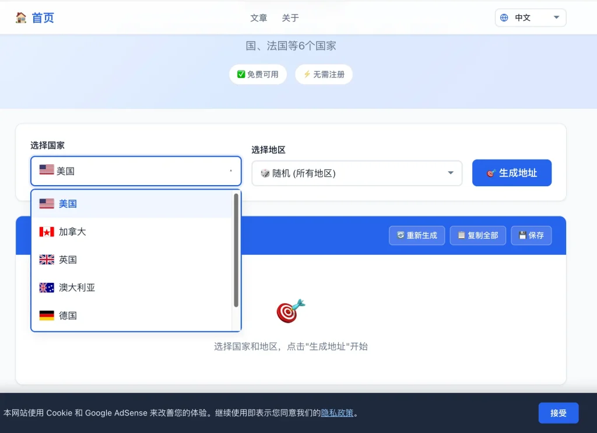
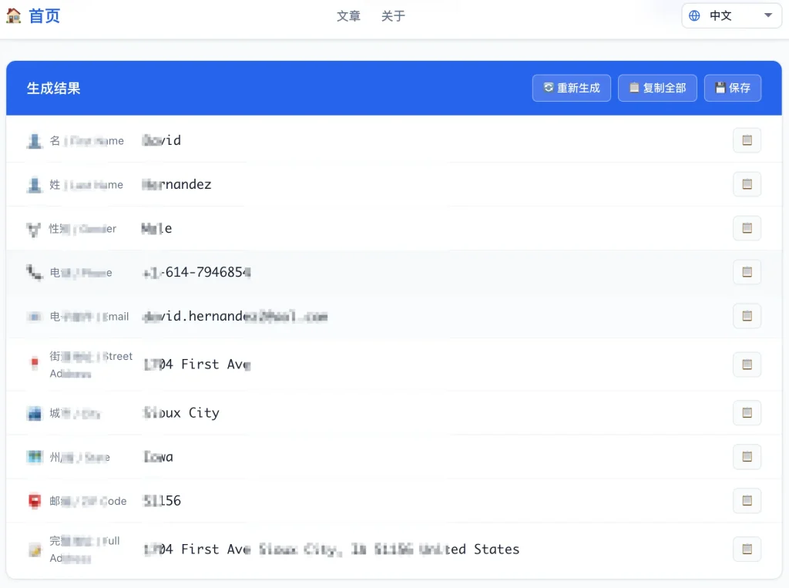

很多人做网站、开发项目、测试表单时，经常会遇到一个小问题：

**姓名、电话、邮箱、街道、城市、邮编到底怎么填？**

一个个手动编，不仅麻烦，还容易填错。

所以我自己做了一个**在线地址生成器**，把这些常用的测试信息集中到了一起。🌍

---

## 🏠 一个网页，快速生成测试地址

打开网站后，选择对应的**国家和地区**，点击「生成地址」，就可以快速得到一套完整信息。

目前包含：

✅ 姓名  
✅ 性别  
✅ 电话号码  
✅ Email  
✅ 街道地址  
✅ 城市  
✅ 州 / 省 / 地区  
✅ ZIP Code / 邮编  
✅ 完整地址

生成后还可以：

📋 一键复制  
🔄 重新生成  
💾 保存结果

整个过程非常简单，不需要注册，打开就能使用。

---

## 🌍 支持多个国家和地区

工具目前支持多个国家，例如：

🇺🇸 美国  
🇨🇦 加拿大  
🇬🇧 英国  
🇦🇺 澳大利亚  
🇩🇪 德国  
🇫🇷 法国等

而且不同国家的地址格式、州/地区和邮编规则并不完全一样。

所以相比自己随便编一组数据，使用专门的**地址生成器**会方便很多。

---

## 💻 这个工具有什么用？

它主要适合**开发、测试和演示**场景。

例如：

👨‍💻 测试注册页面  
🧪 测试网站表单  
🛒 测试电商订单  
📱 测试 App  
🌐 测试地址填写功能  
🎨 产品演示

需要测试：

**姓名 + 电话 + 邮箱 + 地址 + 邮编**

的时候，直接生成一套即可。

---

# 💰 重点来了：它还能做成一个副业项目

如果只是自己使用，它就是一个方便的小工具。

但如果把它做成一个独立网站，就可以进一步尝试做成一个**SEO工具站**。

例如针对用户搜索需求，布局：

🔎 美国地址生成器  
🔎 美国随机地址  
🔎 英国地址生成器  
🔎 加拿大地址生成器  
🔎 澳大利亚地址生成器  
🔎 随机地址生成器  
🔎 测试地址生成器  
🔎 ZIP Code 生成器  
🔎 在线地址生成器

这些都是比较适合工具站布局的长尾关键词。

---

## 📈 工具 + SEO，才是长期玩法

网站不能只有一个生成器。

还可以增加一些实用文章，例如：

**《美国地址格式完全指南》**

**《美国 ZIP Code 是什么？》**

**《英国地址格式怎么填写？》**

**《加拿大地址格式详解》**

**《跨境电商常见地址格式对比》**

用户通过搜索引擎进入文章，再进入工具使用。

简单来说就是：

**SEO文章 → 搜索流量 → 地址生成器 → 用户使用**

慢慢积累下来，就有机会形成长期的自然流量。🔥

---

# 📢 有流量之后，还可以接广告

这也是我做这个项目比较重要的一点。

工具本身可以免费提供给用户使用，网站有流量后，可以根据广告平台规则接入**第三方广告**。

例如：

📌 首页广告位  
📌 工具区域广告位  
📌 文章页面广告位

用户正常使用工具的同时展示广告，从而尝试获得广告收益。💰

**广告接入的具体方法，我已经录制了视频教程。**

从项目部署到广告加入，视频里都有详细操作，想自己搭建的可以直接跟着视频做。

---

# 🚀 后续还能继续扩展

地址生成器只是一个开始。

后面还可以继续加入：

📧 测试邮箱生成器  
🏠 地址格式生成器  
📮 ZIP Code 查询  
🌍 更多国家和地区  
🧪 更多测试数据工具

最终可以慢慢做成一个：

### **在线测试数据工具箱**

一个项目，多个工具，多组 SEO 关键词，也就有了更多获取流量的机会。

---

# 🔥 总结

这个项目的思路其实很简单：

**做一个实用的小工具**

↓

**免费开放给用户**

↓

**围绕关键词做 SEO**

↓

**获取搜索流量**

↓

**接入第三方广告**

↓

**尝试做成自己的副业项目 💰**

不一定非要做一个特别复杂的网站，有时候一个解决具体问题的小工具，同样有机会获得用户。

如果你也想找一个**低成本、适合个人开发者、可以做 SEO、还能尝试广告变现的工具项目**，这个地址生成器可以研究一下。

> ⚠️ 生成的信息仅用于开发、测试、演示等合法场景，不要用于冒充真实身份、欺诈或绕过平台验证。所有法律责任自己承担。

## 相关截图：

**博主演示站：[https://address.aixmb.cn](https://address.aixmb.cn)**

**🔗源码地址:[https://pan.quark.cn/s/3dadc5122e79](https://pan.quark.cn/s/3dadc5122e79)**
