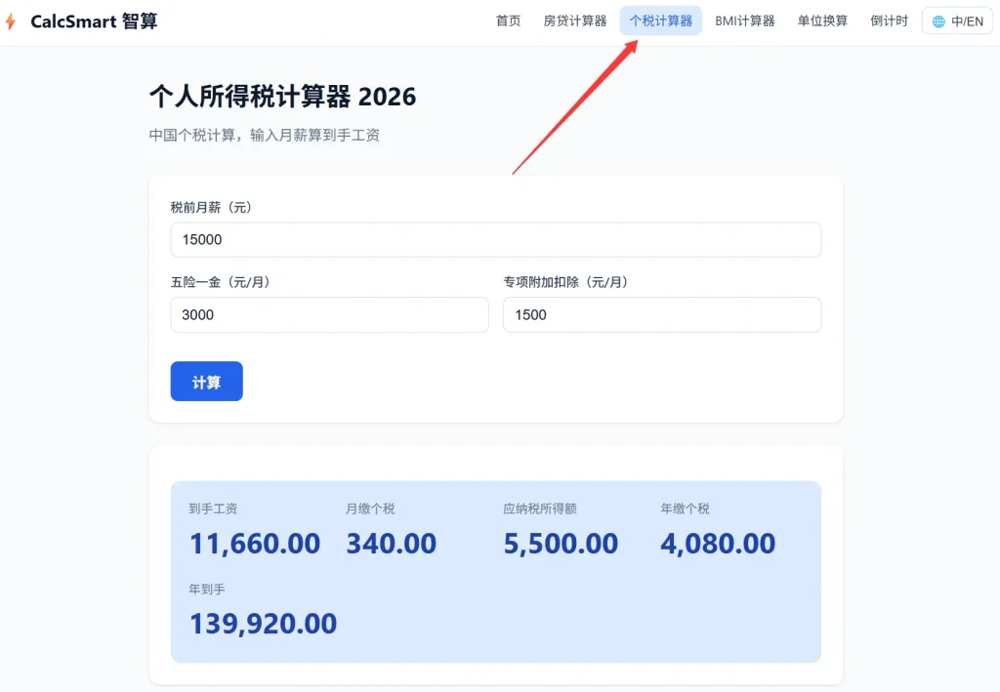
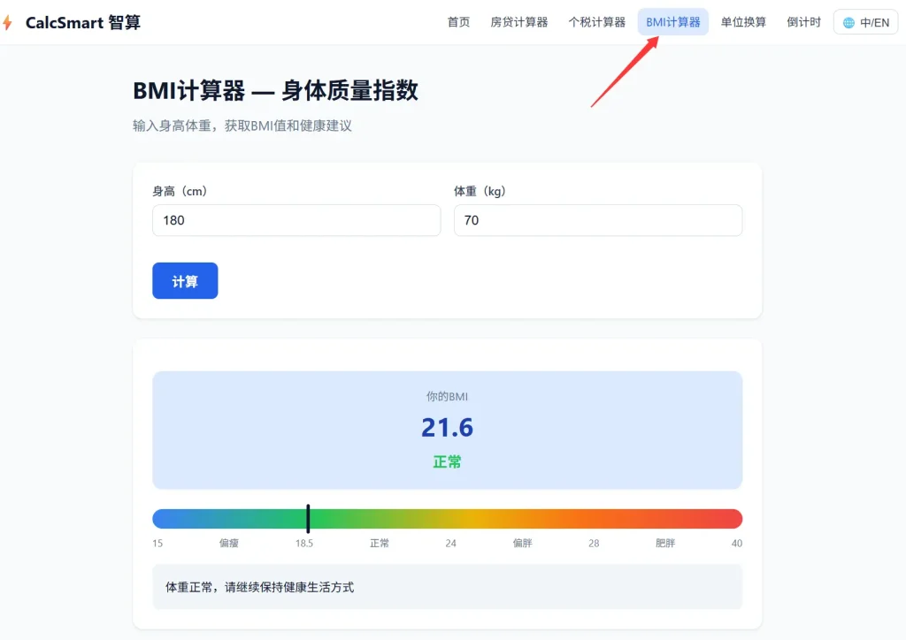
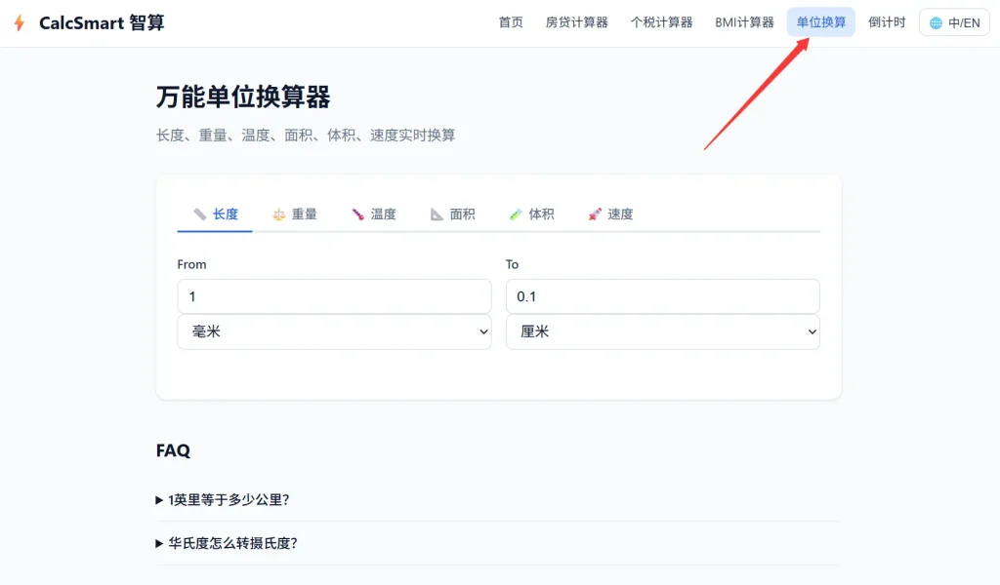

你有没有发现？

很多人在生活和工作中，经常会遇到各种计算需求：

🏠 房贷怎么算？  
💰 个税怎么算？  
⚖️ BMI 是否正常？  
📏 单位怎么转换？  
⏰ 日期还有多少天？  
📊 百分比怎么算？

虽然网上有很多计算工具，但体验往往不够好，有的广告太多，有的功能分散，有的还需要注册。

所以我自己搭建了一个 **CalcSmart 智算工具站**，集合多种常用在线计算工具，让用户打开网页即可使用。👇

---

# 🧮 CalcSmart 智算是什么？

CalcSmart 是一个免费的**在线计算器工具集合网站**。

目前包含：

✅ 房贷计算器  
✅ 个税计算器  
✅ BMI计算器  
✅ 单位换算工具  
✅ 倒计时工具  
✅ 年龄计算器  
✅ 利息计算器  
✅ 税后工资计算器  
✅ 百分比计算器  
✅ 更多实用计算工具持续更新

用户无需下载安装软件，打开网站即可快速计算。

---

# 🖼️相关截图








---

# 🔥 为什么这类工具适合做网站副业？

计算器属于非常典型的**刚需型工具**。

用户搜索目的非常明确：

🔎 房贷计算器  
🔎 工资税后计算器  
🔎 BMI计算器  
🔎 年龄计算器  
🔎 利息计算器  
🔎 在线单位换算

这些关键词每天都有大量搜索需求。

相比一些内容网站，工具类网站的优势是：

用户搜索 → 进入网站 → 直接使用

体验简单，用户需求明确。

---

# ☁️ Cloudflare 零成本部署

这个项目源码可以通过 **Cloudflare** 进行部署。

相比传统服务器：

❌ 不需要购买服务器  
❌ 不需要复杂环境配置  
❌ 不需要长期维护服务器

利用 Cloudflare 的全球网络，可以快速上线自己的在线工具网站。

🎬 从项目搭建  
🎬 Cloudflare 部署  
🎬 网站上线  
🎬 接入第三方广告

整个流程都有详细演示，跟着教程操作即可。

---

# 💰 如何通过广告增加副业收入？

工具免费提供给用户使用，当网站拥有一定访问量后，可以根据广告平台规则接入**第三方广告**。

常见广告位置：

📌 首页工具列表区域  
📌 计算结果页面  
📌 博客文章页面

用户正常使用工具，同时看到广告展示，从而形成工具网站的变现模式。

简单来说：

```
免费工具
 ↓
SEO获取流量
 ↓
用户使用计算器
 ↓
展示第三方广告
 ↓
获得广告收益
```

当然，广告收益会受到访问量、用户来源、广告平台政策等因素影响，需要长期运营。

---

# 📈 SEO 才是工具站长期发展的关键

一个工具网站，不能只有功能。

还需要围绕用户搜索需求制作内容。

例如：

### 房贷计算器 SEO

- 房贷利率怎么算？
- 房贷月供计算方法
- 等额本金和等额本息区别

### 个税计算器 SEO

- 个人所得税怎么算？
- 工资5000需要交税吗？
- 税后工资如何计算？

### BMI计算器 SEO

- BMI正常范围是多少？
- BMI计算公式
- 如何计算自己的BMI？

通过：

**文章内容 + 工具页面**

可以不断获取搜索流量。

---

# 🚀 后续还能扩展更多工具

一个计算器网站，不应该只做几个功能。

未来还可以增加：

📅 日期计算器  
💵 汇率计算器  
📐 面积计算器  
⚡ 电费计算器  
📦 体积计算器  
📊 数据统计工具  
📝 更多生活实用工具

慢慢打造一个：

**在线工具箱平台**

---

# 🎯 适合哪些人？

👨‍💻 程序员  
🌐 个人站长  
🛠️ 工具网站开发者  
📱 自媒体创业者  
💰 想尝试互联网副业的人

不需要一开始做一个大型网站。

一个解决用户真实需求的小工具，也有机会通过 SEO 获得长期流量。

---

# ⭐ 总结

CalcSmart 这类在线计算工具项目，核心思路很简单：

**实用工具 → Cloudflare 免费部署 → SEO获取流量 → 第三方广告变现**

低成本、易维护，而且可以不断扩展功能。

如果你也想搭建一个属于自己的工具网站，可以参考这个项目。

🎬 **完整的 Cloudflare 部署 + 广告接入视频教程已经准备好，按照教程一步一步操作即可。**

从一个小工具开始，打造属于自己的副业项目 🚀

> ⚠️ 广告收益取决于实际流量和广告平台规则，建议遵守各广告平台政策，长期运营优化。

### **博主演示站：[https://calc.kixtools.com](https://calc.kixtools.com)**

### **🔗源码地址：[https://github.com/aixmbcom/calcsmart-kixtools](https://github.com/aixmbcom/calcsmart-kixtools)**
