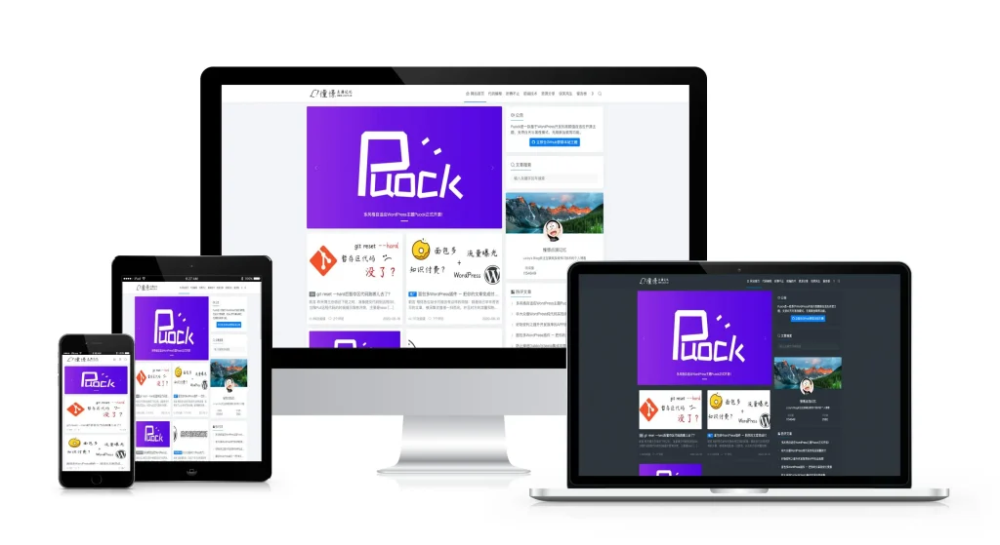
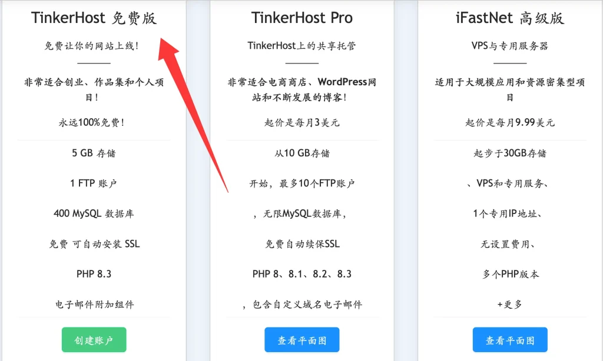
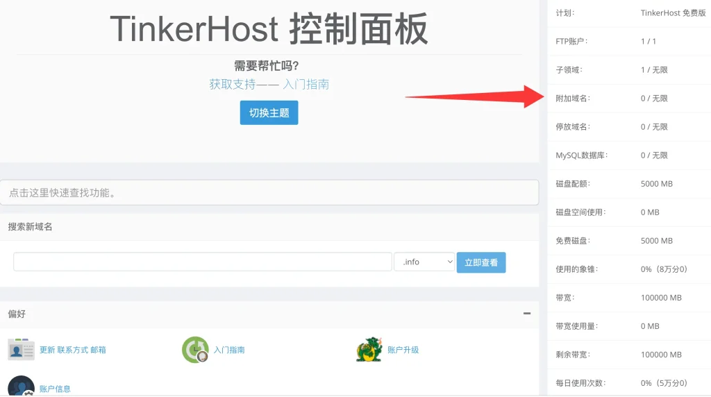

想搭一个自己的 WordPress 博客，但一想到：

❌ 买服务器要花钱  
❌ 买域名之后还要买主机  
❌ 配环境太麻烦  
❌ 新手折腾半天还不一定能跑起来

其实，如果你只是想做一个**个人博客、SEO网站、项目展示站或者练手网站**，一开始真的没必要上来就买高配置服务器。

最近发现一个比较适合新手折腾的免费虚拟主机：

👉 **TinkerHost**

而且最关键的是：

**免费。**

---

## 🆓 TinkerHost 到底能干什么？

TinkerHost 提供的是免费共享 Web Hosting，并不是传统意义上的 VPS。

但对于普通 WordPress 博客来说，基础功能已经比较齐全。

官方免费方案目前提供：

- 💾 约 5 GiB 磁盘空间
- 🌐 免费子域名
- 🔐 SSL/TLS
- 📁 FTP 文件管理
- 🗄️ MySQL + phpMyAdmin
- ⚙️ PHP 环境
- 🚀 Softaculous 一键安装
- ☁️ 支持 Cloudflare
- 📊 基础网站统计
- 🔧 .htaccess
- ⏰ Cron Jobs
- 🔀 URL 重定向

官方还给出了超过 100GB/月的带宽额度、每天超过 50,000 次访问量等免费方案限制。具体额度可能随服务政策调整，以官网为准。

对于一个刚开始做博客的人来说，**够用了。**

---

# ❤️ 最适合拿来干什么？

我觉得它最大的价值并不是：

> “免费服务器有多牛。”

而是：

> **让普通人可以低成本开始做自己的第一个网站。**

比如：

### 📝 个人博客

写技术文章、经验分享、教程、工具推荐。

### 🔍 SEO 网站

围绕一个细分关键词持续更新内容，通过搜索引擎获取自然流量。

### 🧰 工具网站

计算器、在线工具、查询工具等，都可以作为项目尝试。

### 🎨 个人作品集

程序员、设计师、自由职业者都可以做一个自己的展示网站。

### 🧪 WordPress 练手

想学 WordPress，又不想一开始就购买服务器？

**TinkerHost 就可以作为练手环境。**

---

# ⚡ 最方便的地方：WordPress 可以直接安装

这也是我比较推荐它的一个原因。

TinkerHost 官方提供 **Softaculous Auto Installer**，可以直接从控制面板安装 WordPress，不需要自己手动上传 WordPress 文件、创建数据库再慢慢配置。官方介绍称，整个安装过程可以在几分钟内完成。

所以整个思路其实非常简单：

**TinkerHost 免费主机**

↓

**安装 WordPress**

↓

**选择主题**

↓

**发布文章**

↓

**做 SEO**

↓

**慢慢积累搜索流量**

这才是我觉得这个项目比较有意思的地方。

---

# 🔥 免费主机，也可以做 SEO？

当然可以。

SEO 真正重要的并不是你服务器花了多少钱。

更重要的是：

**内容 + 关键词 + 网站结构 + 页面体验 + 持续更新。**

比如你做一个 WordPress 技术博客，可以围绕：

- WordPress 教程
- 免费虚拟主机
- 免费建站
- Cloudflare 教程
- WordPress 插件
- 网站 SEO
- 网站运营
- 免费工具

不断产出文章。

慢慢形成一个属于自己的内容网站。

这比一开始花几百上千块买服务器，然后网站放在那里吃灰，实际得多。😄

---

# 💰 那能不能做副业？

可以尝试。

比如：

**免费主机 + WordPress + SEO + 内容 + 广告**

就是一个非常适合新手研究的低成本模式。

网站有流量之后，可以根据自身情况尝试：

📌 第三方广告  
📌 联盟推广  
📌 工具推荐  
📌 付费服务  
📌 自己的产品  
📌 内容引流

TinkerHost 官方 WordPress 页面也明确说明，他们不会强制在用户网站上投放自己的广告，用户可以自行决定是否放置广告。

当然，**免费不等于无限制赚钱机器**。

网站能不能获得流量，最终还是取决于内容和运营。

---

# 🎬 我的视频已经帮你把 WordPress 搭建过程做好了

如果你看到这里，刚好也想自己试一下。

**利用 TinkerHost 免费虚拟主机搭建 WordPress 博客。**

从主机使用，到 WordPress 网站搭建，视频会比文字教程更加直观。

不想研究复杂服务器配置的朋友，可以直接跟着视频操作。

---

# ⚠️ 免费主机也不是万能的

这一点还是要说清楚。

TinkerHost 是免费共享主机，资源和付费 VPS、独立服务器肯定不能相提并论。

官方也提醒，一些资源消耗较大的 WordPress 插件可能不适合免费环境，例如 Jetpack、Elementor 等。

所以比较适合：

✅ 个人博客  
✅ SEO 内容站  
✅ 学习 WordPress  
✅ 个人主页  
✅ 小型项目  
✅ 网站测试

不太适合：

❌ 大型高并发网站  
❌ 高资源消耗项目  
❌ 大量文件存储  
❌ 对服务器性能要求很高的网站

---

# 🎯 最后总结

如果你只是想：

> **花尽可能少的钱，搭一个属于自己的 WordPress 网站。**

那么 TinkerHost 值得收藏。

它最大的优势并不是“服务器性能有多强”，而是：

**免费 + WordPress + PHP + MySQL + SSL + FTP + Softaculous + Cloudflare 支持。**

对于刚开始学建站的人来说，最大的成本往往不是服务器。

而是——

**迟迟没有开始。**

有兴趣的话，可以先搭起来。

网站真正做起来以后，再考虑升级服务器也不迟。🚀

## 🎨 搭配 Puock，打造一个真正属于自己的漂亮博客

WordPress 搭好了，接下来最重要的就是——**网站颜值！**

如果你不想使用千篇一律的默认主题，可以试试这款开源 WordPress 主题：**Puock**。

Puock 开源主题 GitHub

Puock 是一款专门为 WordPress 打造的高颜值自适应主题，支持**明暗模式、博客/CMS/企业布局、无刷新加载、SEO 优化、文章目录、评论、点赞、分享、广告位、懒加载**等一系列功能。

# 🖼️相关截图

**TinkerHost：[https://tinkerhost.net](https://tinkerhost.net)**

**argon主题下载：[https://github.com/solstice23/argon-theme](https://github.com/solstice23/argon-theme)**

**国内网盘下载：[https://pan.quark.cn/s/267c50773092](https://pan.quark.cn/s/267c50773092)**

**puock主题下载：[https://github.com/Licoy/wordpress-theme-puock](https://github.com/Licoy/wordpress-theme-puock)**

**国内网盘下载：[https://pan.quark.cn/s/e001cf45331a](https://pan.quark.cn/s/e001cf45331a)**

---

> 本文转载整理自 [Ai星码博客](https://aixmb.com/933.html)，版权归原作者所有。

