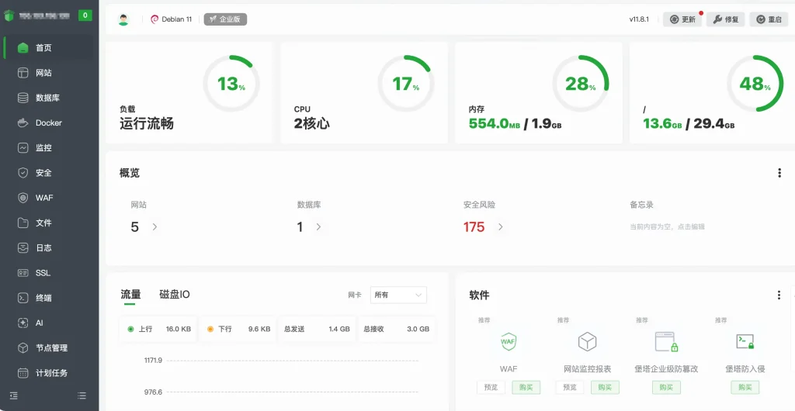
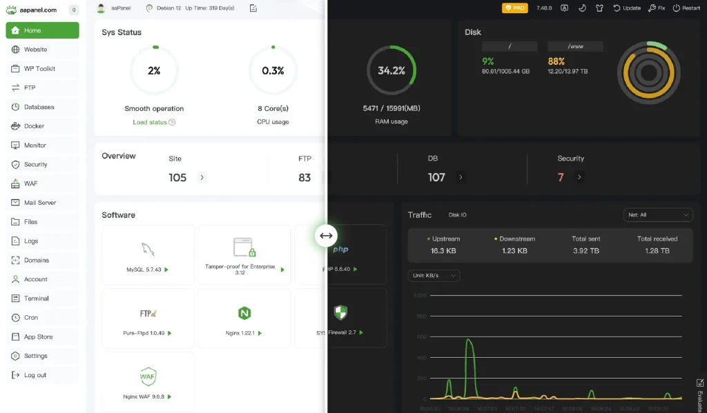
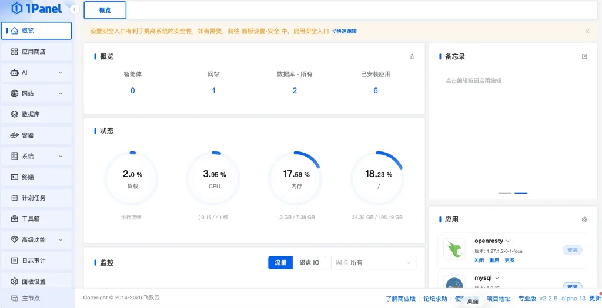

很多刚接触服务器的朋友，都会遇到一个问题：

**服务器买好了，然后呢？** 😵‍💫

Linux 命令不会用，文件不知道放哪里，网站环境不会配置，PHP、MySQL、Nginx 更是一脸懵。

其实对于新手来说，服务器管理没必要一上来就死磕命令行。

**安装一个服务器管理面板，就简单多了。**

今天整理了 3 款比较常见的服务器面板：

👉 **宝塔面板**  
👉 **aaPanel**  
👉 **1Panel**

并且我已经专门录制了详细的视频教程，**从服务器连接，到面板安装，再到后续基本使用，都进行了演示。**

---

## 🛠️ 宝塔面板

宝塔应该是很多国内新手接触服务器时最熟悉的面板之一。

安装完成之后，可以通过网页后台管理服务器。

比如：

🌐 创建网站  
📂 管理文件  
🔐 配置 SSL  
🐘 管理 PHP  
🗄️ 创建 MySQL 数据库  
⚙️ 管理网站运行环境  
📊 查看服务器状态

以前需要敲命令完成的事情，现在很多都可以通过可视化界面操作。

**对于第一次使用 Linux 服务器的人，非常适合拿来入门。**

# 🖼️相关截图

---

## 🌍 aaPanel

如果你经常使用海外服务器，那么 **aaPanel** 也值得了解。

它同样提供 Web 可视化管理界面，可以用来管理：

- 网站
- PHP
- MySQL
- Nginx
- 文件
- SSL
- 数据库
- 服务器资源

而且整体操作逻辑比较直观。

对于使用海外 VPS、云服务器搭建网站的朋友，可以把它作为宝塔之外的一个选择。

# 🖼️相关截图

---

## 🚀 1Panel

如果你喜欢更加现代化的服务器管理方式，那么可以看看 **1Panel**。

它最大的特点之一就是对 **Docker / 容器化应用** 支持比较友好。

除了传统的网站管理，还可以方便地部署各种应用。

比如：

🐳 Docker 应用  
📝 WordPress  
🗄️ 数据库  
🌐 网站  
🔐 SSL  
📦 各类开源项目

对于现在越来越多的 Docker 项目来说，1Panel 还是非常值得学习的。

# 🖼️相关截图

---

# 🤔 宝塔、aaPanel、1Panel怎么选？

其实不用纠结太久。

**新手建站：**  
👉 宝塔

**海外服务器：**  
👉 aaPanel

**喜欢 Docker / 开源应用：**  
👉 1Panel

当然，这只是一个简单的入门参考，真正选择哪个面板，还是要看自己的服务器环境和使用需求。

---

这次我没有只写文字教程，而是直接录制了实际操作视频。

从：

**服务器准备**

⬇️

**连接服务器**

⬇️

**安装服务器面板**

⬇️

**进入管理后台**

⬇️

**基础环境配置**

整个过程都进行了演示。

不会 Linux 命令的新手，也可以跟着视频一步一步操作。💻

---

# 🔥 学会服务器面板，你就真正迈过了建站第一步

当你把宝塔、aaPanel 或 1Panel 安装好之后，后面就可以继续折腾各种项目：

**WordPress 博客** 📝  
**个人网站** 🌐  
**导航网站** 🔖  
**开源项目** 🚀  
**Docker 应用** 🐳  
**在线工具站** 🛠️

甚至可以进一步研究 **SEO、网站流量和广告变现**。

所以，与其一直收藏各种教程，不如直接找一台服务器练起来。

**服务器面板会安装，后面的路就好走很多了。** 🚀

### 宝塔：[https://www.bt.cn/new/download.html](https://www.bt.cn/new/download.html)

### aaPanel：[https://www.aapanel.com/new/download.html?from=home](https://www.aapanel.com/new/download.html?from=home)

### 1Panel：[https://1panel.cn/docs/v2/installation/online_installation](https://1panel.cn/docs/v2/installation/online_installation)

---

> 本文转载整理自 [Ai星码博客](https://aixmb.com/952.html)，版权归原作者所有。

