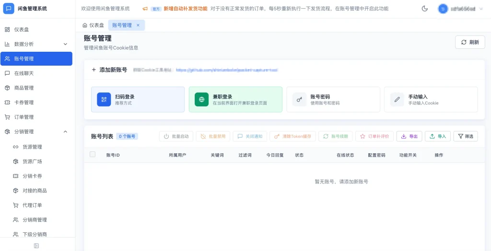
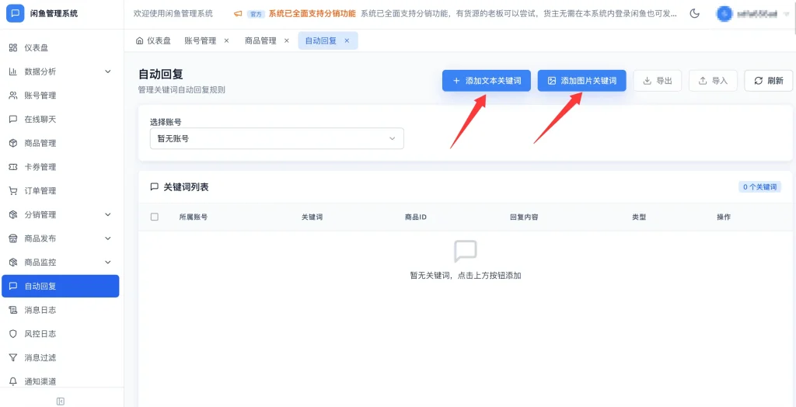
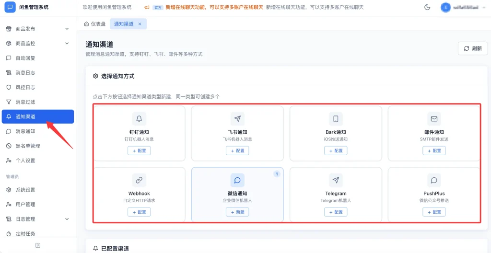

如果你经常在闲鱼上卖东西，应该都有过这种感觉：

买家消息不断 📩  
重复问题不停回复 😵  
订单来了还要手动发货 📦  
账号多了更难管理……

如果只是偶尔卖几个商品还好，但商品和账号多起来以后，**重复性的客服和发货工作真的很耗时间。**

今天分享一个开源项目：**xianyu-auto-reply-fix 闲鱼管理系统**。

---

## 🤖 它到底能干什么？

这不是一个单纯的“自动回复脚本”，而是一套比较完整的**闲鱼自动化管理系统**。

核心功能包括：

### 💬 AI自动回复

支持关键词回复、默认回复、指定商品回复，同时支持 AI 自动回复。

还可以针对不同商品设置不同的回复内容，让客服回复更加灵活。

### 🚚 自动发货

这也是项目比较核心的功能。

可以根据商品和发货规则进行匹配，支持：

📄 文本发货  
📦 批量数据  
🔌 API 发货  
🖼️ 图片发货

同时支持多规格商品，并提供防重复处理机制。

### 👥 多账号管理

如果手里有多个闲鱼账号，可以统一放到后台管理。

支持账号独立启停、状态查看、Cookie维护等功能，还支持商品一键擦亮和定时擦亮。

### 🛍️ 商品管理

系统可以自动收集商品信息，并支持商品详情、规格配置以及数据去重。

对于商品比较多的卖家来说，管理起来会方便不少。

### 📊 日志与数据监控

后台还提供：

📈 系统统计  
📝 实时日志  
❤️ 健康检查  
🔐 安全统计  
💾 数据备份恢复

方便查看系统运行情况。

### **🔔 多渠道消息通知，重要信息及时提醒**

除了自动回复和自动发货，这套闲鱼管理系统还支持**消息通知功能**。

当有订单、消息或者其他重要事件时，可以配置不同的通知渠道进行提醒。📲

目前支持：

🔔 **钉钉通知**  
✈️ **飞书通知**  
📱 **Bark 通知**  
📧 **邮件通知**  
🔗 **Webhook**  
💬 **企业微信通知**  
✈️ **Telegram 通知**  
💭 **PushPlus 通知**

这样就不用一直盯着闲鱼后台。

**有新消息 → 系统处理 → 发送通知 → 手机及时收到提醒** 🚀

---

## 🐳 Docker 一键部署

对于喜欢自己搭服务器的朋友，这个项目也比较友好。

项目支持 **Docker / Docker Compose** 部署，可以直接在服务器上运行，不需要自己一步一步配置复杂的 Python 环境。官方 README 将 Docker Compose 作为推荐部署方式。

技术栈方面，项目使用 **FastAPI + SQLite + Playwright**，并采用异步处理和浏览器自动化等技术。

---

## 🔥 为什么值得关注？

我觉得它最大的特点就是：

**把闲鱼卖家每天重复做的事情集中到了一个后台。**

以前：

买家咨询 → 手动回复  
订单付款 → 手动处理  
商品多了 → 一个个管理

现在可以尝试：

**账号管理 + 智能回复 + 商品管理 + 自动发货 + 日志监控**

全部集中处理。🚀

当然，自动化工具使用时还是要遵守闲鱼平台规则，不要用于违规、欺诈等场景；项目本身也明确提示仅供学习研究使用。

---

## 🎯 适合哪些人？

比较适合：

✅ 闲鱼卖家  
✅ 数字商品卖家  
✅ 多账号运营者  
✅ 想学习 Python 自动化的人  
✅ 想研究 AI 客服的人  
✅ 喜欢 Docker / 开源项目的人

如果你平时就在研究**闲鱼自动回复、闲鱼自动发货、闲鱼多账号管理、AI客服、自动化运营**，这个项目可以收藏一下。

# 🖼️相关截图

### **🔗项目地址:[https://github.com/zhinianboke/xianyu-auto-reply](https://github.com/zhinianboke/xianyu-auto-reply)**

---

> 本文转载整理自 [Ai星码博客](https://aixmb.com/963.html)，版权归原作者所有。

