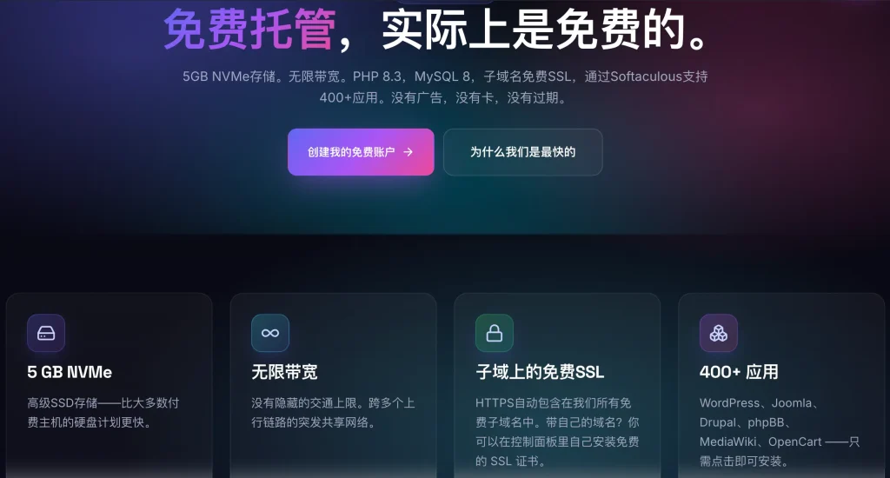
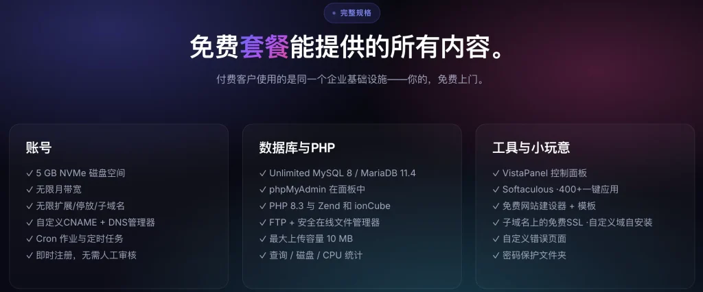

还在为购买虚拟主机、服务器和域名发愁吗？

如果你只是想搭建一个个人博客、WordPress网站、导航站、工具站或项目演示站，其实不一定要一开始就购买付费主机。

今天分享一个值得收藏的免费主机平台：

👉 Byet Host 官网：

它提供永久免费虚拟主机，免费套餐没有试用倒计时，也不会强制到期，适合个人建站和学习使用。官方页面显示，免费套餐包含 5GB NVMe存储、无限带宽、PHP 8.3、MySQL 8、免费SSL以及400多个一键安装应用。

Byet Host

## 🌐 Byet Host免费虚拟主机有什么？

### 💾 5GB NVMe存储

免费套餐提供 5GB NVMe磁盘空间，相比传统机械硬盘，NVMe存储在文件读取和网站运行方面更有优势。

对于个人博客、WordPress网站、小型工具站来说，5GB基本可以满足前期使用。

### 🚀 无限带宽

平台免费套餐提供无限月流量，不需要担心普通个人网站因为访问量增加而频繁购买流量包。

不过，免费虚拟主机依然属于共享主机，实际使用时还是要遵守平台资源和服务条款。

### 🐘 PHP 8.3 + MySQL 8

支持目前常见的网站运行环境：

- PHP 8.3
- MySQL 8
- MariaDB 11.4
- phpMyAdmin
- FTP文件管理
- 在线文件管理器

对于WordPress、博客程序、论坛系统和其他PHP网站来说，基本够用。

## 🔐 免费SSL，网站也能使用HTTPS

Byet Host支持免费SSL证书。

使用平台提供的免费子域名时，可以自动配置HTTPS；如果绑定自己的域名，也可以在控制面板中安装免费SSL证书。

网站启用HTTPS之后，访问更加安全，也更有利于搜索引擎收录和用户信任。🔒

## 📦 400多个应用一键安装

平台集成了 Softaculous应用安装工具，支持400多个网站程序一键安装。

包括：

- WordPress
- Joomla
- Drupal
- phpBB
- MediaWiki
- OpenCart
- 其他博客、论坛和内容管理系统

不需要手动上传大量程序文件，也不用自己配置复杂的运行环境，选择程序后按照提示操作即可。

Byet Host

## ✍️ 搭建WordPress博客很方便

如果你准备做一个自己的博客，Byet Host可以作为入门选择。

大致流程就是：

注册免费主机 → 进入控制面板 → 使用Softaculous安装WordPress → 绑定域名 → 安装主题 → 发布文章

搭配一个漂亮的WordPress主题，再进行基础SEO设置，就可以搭建属于自己的博客系统。

适合用来做：

📝 个人博客 💻 技术分享站 📚 资源导航站 🧰 在线工具站 🎨 作品展示站 🚀 开源项目介绍站

## 🛠️ 免费虚拟主机还支持哪些功能？

除了基础的网站托管，Byet Host还提供不少实用功能：

- 无限子域名、附加域名和停放域名
- 自定义CNAME和DNS管理
- Cron定时任务
- FTP上传文件
- 在线文件管理器
- 自定义错误页面
- 密码保护目录
- 网站统计
- MySQL数据库管理
- 免费网站建设器和模板
- Cloudflare兼容支持

官方还提供VistaPanel控制面板，可以直接在后台管理域名、数据库、文件、SSL和网站应用。

## 💰 适合做副业和低成本建站吗？

如果你正在尝试做：

- 个人博客
- SEO内容站
- 工具导航站
- 开源项目展示站
- WordPress资讯站
- 个人作品集

那么免费虚拟主机可以帮助你降低前期成本。

你可以先用免费主机把网站搭建起来，后续等网站内容和访问量稳定之后，再考虑升级到更高配置的主机或服务器。

不过需要注意，免费主机更适合个人项目、学习建站和小型网站。如果是大型商城、高并发网站或重要商业项目，建议选择资源更充足、备份和技术支持更完善的付费方案。

## ⚠️ 使用前需要注意

虽然Byet Host官方标注免费套餐没有到期时间，但免费虚拟主机仍然有资源限制，例如：

- 磁盘空间为5GB
- 单文件上传大小有限制
- 免费主机属于共享环境
- 不适合运行特别占资源的程序
- 重要网站建议定期备份
- 具体规则以官方最新条款为准

另外，永久免费不等于完全不需要维护。网站程序、WordPress插件和主题仍然需要及时更新，重要数据也建议自行备份。

## 🎯 总结

Byet Host免费虚拟主机的主要特点可以概括为：

永久免费、5GB NVMe存储、无限带宽、PHP 8.3、MySQL 8、免费SSL、400多个应用一键安装。

对于想低成本搭建WordPress博客、个人网站、导航站和工具站的朋友来说，确实值得收藏。

# 🖼️相关截图

### **🔗项目地址:[https://byet.host](https://byet.host)**

---

> 本文转载整理自 [Ai星码博客](https://aixmb.com/985.html)，版权归原作者所有。

