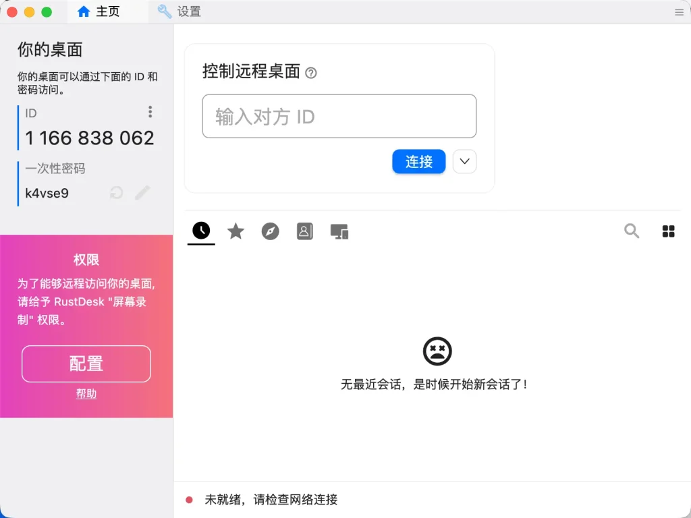
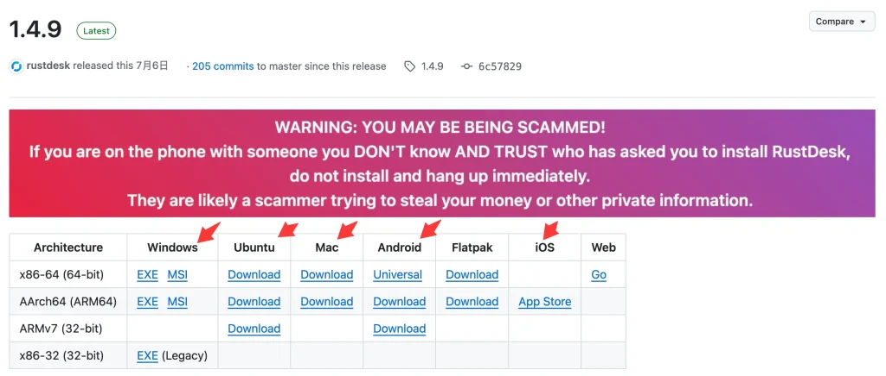

还在使用第三方远程控制软件？担心连接不稳定、功能受限，或者不想把远程连接完全交给平台？

今天分享一个非常值得研究的开源项目——RustDesk。

RustDesk 是一款开源远程桌面软件，支持 Windows、macOS、Linux、Android、iOS 和 Web 等平台。除了直接使用客户端，还可以自己搭建 RustDesk 服务器，实现更加灵活的远程控制和设备管理。

## 🖥️ RustDesk可以用来做什么？

RustDesk主要适合以下场景：

- 🏠 远程控制家里的电脑
- 💻 远程办公和技术支持
- 🛠️ 服务器远程维护
- 👨‍💻 远程协助家人朋友
- 🏢 企业内部设备管理
- 🔐 自建远程桌面服务
- 🌐 跨平台远程连接

相比普通远程控制工具，RustDesk最大的特点之一就是支持自建服务器。

你可以把服务器部署在自己的云服务器上，让客户端通过自建的 ID 服务器和中继服务器进行连接。

## 🐳 为什么选择宝塔Docker部署？

这次教程采用的是：

服务器 + 宝塔面板 + Docker + RustDesk Server

使用宝塔面板部署的好处是操作更加直观，不需要一直输入复杂命令，适合刚开始接触 Docker 和 Linux 服务器的朋友。

通过 Docker 部署，还方便后续进行：

- 容器启动和停止
- 日志查看
- 配置修改
- 数据持久化
- 服务更新
- 故障排查

RustDesk官方也推荐使用 Docker 或 Docker Compose 部署自建服务，方便重复部署、升级和迁移。

## ⚙️ RustDesk服务器由什么组成？

RustDesk自建服务器主要包含两个核心服务：

### 1. hbbs：ID与信号服务器

主要负责帮助客户端找到目标设备，并协调双方建立连接。

### 2. hbbr：中继服务器

当两台设备无法通过点对点方式直接连接时，就会通过中继服务器转发连接数据。

简单理解就是：

客户端 → hbbs寻找设备 → 尝试直连 → 直连失败后通过hbbr中继

RustDesk官方文档也说明，大多数情况下会优先尝试点对点连接，只有直连失败时才会使用中继服务。

## 📋 教程主要内容

这次录制的是一套详细的保姆级教程，主要包括：

✅ 服务器基础环境准备 ✅ 宝塔面板安装与使用 ✅ Docker环境配置 ✅ RustDesk服务端部署 ✅ hbbs和hbbr容器创建 ✅ 数据目录映射 ✅ 防火墙端口放行 ✅ 获取服务器Key ✅ RustDesk客户端配置 ✅ 远程连接测试 ✅ 常见问题排查 ✅ 容器日志查看与重启

RustDesk服务端常用端口包括：

- TCP：21115、21116、21117
- UDP：21116
- 其他端口根据是否使用Web客户端等功能决定

官方文档建议根据实际使用需求开放端口，不需要的WebSocket端口可以保持关闭。

## 🔑 客户端如何连接自建服务器？

服务端部署完成后，需要在RustDesk客户端中填写：

- ID服务器地址
- 中继服务器地址
- 服务器公钥Key

配置完成后，客户端就可以使用自己的RustDesk服务器进行设备发现和远程连接。

如果连接失败，通常可以重点检查：

- 服务器端口是否放行
- Docker容器是否正常运行
- hbbs和hbbr是否启动
- 域名或IP是否填写正确
- Key是否匹配
- 云服务器安全组是否开放对应端口

## 🎥 视频教程适合哪些人？

这套视频教程适合：

👨‍💻 想学习RustDesk自建服务器的人 🐳 想通过Docker部署开源项目的人 🖥️ 想搭建远程控制服务的人 🛠️ 正在使用宝塔面板管理服务器的人 🔐 希望掌握远程桌面服务部署方法的人

视频会从服务器环境开始讲解，逐步完成宝塔、Docker和RustDesk服务端配置，尽量让没有部署经验的朋友也能跟着操作。

## ⚠️ 使用时需要注意

自建RustDesk服务器虽然灵活，但仍然需要注意服务器安全：

- 及时更新系统和Docker镜像
- 不要随意公开服务器Key
- 只开放必要端口
- 使用强密码保护服务器
- 定期查看容器日志
- 不要将远程控制权限交给不可信用户

如果是企业或重要设备，建议进一步配置访问控制、权限管理和安全策略。

## 🎯 总结

RustDesk是一款功能完整的开源远程桌面工具，支持跨平台远程控制，也支持用户自己搭建服务器。

这次通过宝塔Docker部署RustDesk Server，可以更直观地完成：

服务器准备 → Docker部署 → hbbs/hbbr运行 → 客户端配置 → 远程连接

如果你正在寻找 RustDesk自建服务器教程、RustDesk Docker部署、宝塔安装RustDesk、RustDesk中继服务器搭建，这套视频教程可以收藏起来。🚀

# 🖼️相关截图

### **🔗项目地址:[https://github.com/rustdesk/rustdesk](https://github.com/rustdesk/rustdesk)**
